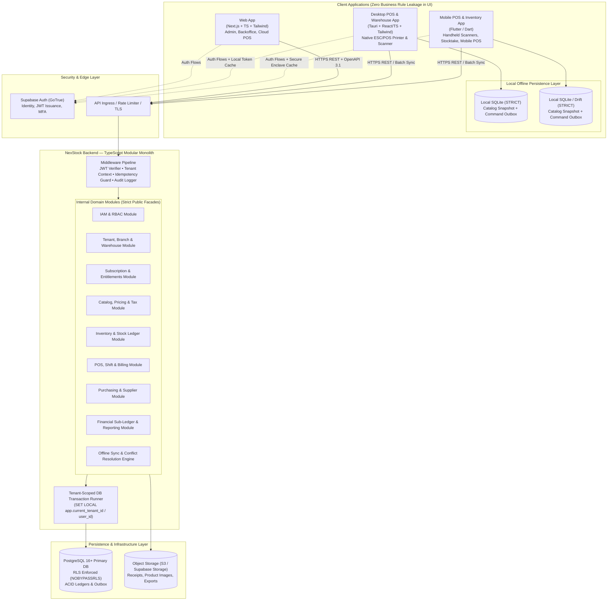

# 02 — System Architecture Document

| Metadata | Details |
| :--- | :--- |
| **Document ID** | `NEX-DOC-02` |
| **Status** | Approved Baseline (Rev 1.1 — UD-01..UD-05 Incorporated) |
| **Architecture Style** | Modular Monolith Backend (Fastify + TypeBox + Kysely) + Multi-Platform Clients |

---

## 1. Technology Stack Compatibility Evaluation

Per project constraints, we do not assume the proposed stack integrates seamlessly out of the box. Below is a rigorous engineering evaluation of each proposed component, its integration friction points, and the architectural rules required to make them work cohesively.

### 1.1 Compatibility Matrix & Friction Analysis

| Component | Approved Tech | Verdict | Integration Friction & Technical Nuances | Enforced Architectural Pattern |
| :--- | :--- | :--- | :--- | :--- |
| **Web Client (`UD-02`, `UD-04`)** | Next.js + TypeScript + Tailwind CSS (Online-First) | **Compatible (with strict boundaries)** | Next.js App Router encourages putting database queries inside Server Components/Server Actions, which violates Principles #1–#4 (business rules out of UI, server-side API authorization). | Use Next.js strictly as an online-first presentation layer for back-office management, reporting, and cloud POS. **All business logic and authorization live exclusively in `apps/api`**. Browser OPFS/WASM SQLite is deferred. |
| **Desktop Client (`UD-02`, `UD-04`)** | Tauri v2 + Vite React/TS SPA + Local SQLite | **Highly Compatible** | Tauri embeds a static frontend inside an OS WebView and provides native Rust bridges for local SQLite, ESC/POS thermal printers, and USB/Serial barcode scanners. | Build `apps/desktop` using a **Vite + React + TypeScript SPA** inside Tauri, sharing reusable React + Tailwind UI components via `packages/ui` and TypeBox contracts via `packages/contracts`. |
| **Mobile Client (`UD-04`)** | Flutter + SQLite (`drift` / `sqflite`) | **Compatible (Cross-Language Contract Boundary)** | Flutter uses **Dart**, whereas Web/Desktop/Backend use **TypeScript**. Business formulas and offline SQLite schemas must not drift between TS and Dart. | 1. Generate both TypeScript and Dart clients from OpenAPI 3.1 specs emitted by Fastify + TypeBox.<br>2. Share canonical SQLite `STRICT` migration files (`packages/sqlite-schema`).<br>3. Gate CI on shared JSON calculation test vectors (`packages/domain-core/test-vectors`). |
| **Backend API (`UD-01`)** | Fastify + TypeBox + Kysely (TypeScript) | **Highly Compatible** | Requires explicit alignment between TypeBox JSON Schema keywords, Fastify's Ajv validator, OpenAPI 3.1 output, and Kysely's `pg` driver type serialization (`NUMERIC`/`BIGINT` returned as strings). | Standardize on `@sinclair/typebox` + `@fastify/type-provider-typebox` + `@fastify/swagger` and Kysely `PostgresDialect` with transaction-scoped `SET LOCAL` RLS helpers (detailed in Section 1.2 below). |
| **Primary Database** | PostgreSQL 16+ | **Highly Compatible** | Ideal for ACID financial transactions, row-level locking (`FOR UPDATE`), partitioned append-only ledgers, and native Row Level Security (RLS). | Use PostgreSQL 16+ with `UUID` (UUIDv7), `NUMERIC(19,4)` money columns, `NUMERIC(18,6)` quantity columns, and composite tenant foreign keys. |
| **Authentication** | Supabase Auth (GoTrue) | **Compatible (Requires JWT Claim Sync)** | Supabase Auth issues JWTs, while fine-grained RBAC and location scopes live in PostgreSQL. | Verify Supabase JWTs in Fastify `onRequest` hook via cached JWKS; resolve active `tenant_id`, role permissions, and branch/warehouse scopes on the server. |
| **Database Authorization** | PostgreSQL Row Level Security (RLS) | **Compatible (CRITICAL Connection Pooling Nuance)** | In a pooled Node.js `pg.Pool` connection, session-level `SET` leaks across requests, and table owners bypass RLS by default. | Connect Kysely using a dedicated `nexstock_app_user` role with `NOBYPASSRLS` and execute all tenant queries inside a Kysely transaction that runs `SELECT set_config('app.current_tenant_id', $1, true)`. |
| **Offline Storage** | SQLite 3.37+ `STRICT` (Tauri & Flutter) | **Highly Compatible** | SQLite uses dynamic typing unless `STRICT` mode is enabled. | Enforce `STRICT` and `WAL` mode on all local SQLite tables; store UUIDv7 as `TEXT`, timestamps as ISO-8601 UTC `TEXT`, and money/quantities as exact integer minor/micro units or canonical decimal strings. |

---

### 1.2 Deep-Dive Compatibility Evaluation: Fastify + TypeBox + Kysely (`UD-01`)

Before writing any code, we evaluate the specific technical interactions between **Fastify v5**, **TypeBox (`@sinclair/typebox`)**, and **Kysely (`kysely` + `pg`)**:

1. **Fastify Ajv Strict Mode vs. TypeBox OpenAPI Metadata**:
   - *Integration Detail*: TypeBox allows attaching OpenAPI documentation properties (e.g., `description`, `examples`) to schemas. Fastify's default Ajv instance in `strict: true` mode throws startup errors if unknown keywords appear, or if TypeBox's `Type.Transform` is passed directly to Ajv without decoding.
   - *Architectural Rule*: Define pure JSON Schema wire contracts in `packages/contracts` using standard TypeBox primitives (`Type.Object`, `Type.String({ format: 'uuid' })`, `Type.RegExp(/^-?\d+(\.\d{1,4})?$/)` for fixed-point decimals). Configure Fastify's Ajv compiler to allow standard OpenAPI metadata keywords (`example`, `examples`) and perform domain Value Object parsing (`Money.fromDecimalString()`, `Quantity.fromDecimalString()`) explicitly in the application boundary rather than relying on implicit Ajv type coercion (`coerceTypes: false` for body payloads to prevent silent number-to-float corruption!).
2. **Kysely + `node-postgres` (`pg`) Numeric & BigInt Serialization**:
   - *Integration Detail*: By default, `pg` returns PostgreSQL `NUMERIC` (OID 1700) and `BIGINT` (`int8`, OID 20) columns as JavaScript `string` values because JavaScript `Number` loses precision beyond $2^{53}-1$ or on decimal fractions.
   - *Architectural Rule*: **Never override `pg.types.setTypeParser(1700, parseFloat)`**. Keep Kysely's generated column types for `NUMERIC(19, 4)` and `NUMERIC(18, 6)` typed as `ColumnType<string, string, string>` (branded `DecimalString`). Our `Money` and `Quantity` domain value objects accept and emit these exact canonical decimal strings, which also match our TypeBox API response schemas with zero floating-point conversion loss.
3. **Kysely Transaction Scope & PostgreSQL RLS (`SET LOCAL`)**:
   - *Integration Detail*: Kysely's `db.selectFrom(...)` checks out a random connection from `pg.Pool` for a single statement and immediately releases it. Running `set_config(..., true)` outside a Kysely transaction has **no effect** on the next query because the next query may grab a different pooled connection!
   - *Architectural Rule*: Do not expose the raw root `Kysely<Database>` instance to module repositories. Instead, module repositories only accept a branded `TenantTransaction<Database>` (`Transaction<Database>` subtype) created exclusively by `withTenantTransaction(ctx, async (trx) => { ... })`, which pins a single pooled connection inside `BEGIN ... COMMIT` and runs `set_config('app.current_tenant_id', ctx.tenantId, true)` as its first statement.
4. **Kysely Dynamic Locks & Savepoints for Offline Batch Sync**:
   - *Integration Detail*: Kysely natively supports `.forUpdate()` and `.forUpdate().skipLocked()` on `SELECT` queries (critical for `inventory_balances` row locking and `outbox_events` polling), and supports nested `SAVEPOINT` execution via custom `sql\`SAVEPOINT sp_${sql.raw(index)}\`` inside a batch transaction for poison-pill isolation during `/v1/sync/push`.

---

## 2. High-Level System Architecture



---

## 3. Repository & Monorepo Topology

To support Web, Tauri Desktop, TypeScript Backend, shared contracts, and Flutter Mobile without circular dependencies or duplicated specifications, we recommend a **Workspace Monorepo** (using `pnpm` workspaces + `Turborepo` for TypeScript packages, alongside a top-level `apps/mobile` Flutter workspace driven by OpenAPI codegen):

```text
nexstock/
├── apps/
│   ├── api/                  # Standalone TypeScript Modular Monolith Backend (Fastify + TypeBox + Kysely)
│   ├── web/                  # Next.js Web Application (Online-First Backoffice, Reporting, Cloud POS)
│   ├── desktop/              # Tauri v2 + Vite React/TS SPA (Offline-First Desktop POS & Warehouse)
│   └── mobile/               # Flutter Application (Offline-First iOS/Android Inventory & Mobile POS)
├── packages/
│   ├── contracts/            # TypeBox schemas + generated OpenAPI 3.1 specs & Sync Envelope contracts
│   ├── domain-core/          # Pure, side-effect-free TS domain calculators (Money, Tax, UoM, Rounding)
│   │                         # + JSON compliance test vectors consumed by both TS and Dart tests!
│   ├── ui/                   # Shared React + Tailwind CSS design system (used by apps/web & apps/desktop)
│   ├── sqlite-schema/        # Canonical SQLite STRICT migration SQL files shared by Tauri & Flutter
│   └── config/               # Shared tsconfig, eslint, prettier, tailwind configurations
└── docs/                     # Architecture, ADRs, ERD, API & Sync specifications
```

> [!TIP]
> **Solving the TypeScript vs. Dart Logic Parity Risk**:
> `packages/domain-core` defines canonical JSON test vectors for every deterministic formula (tax inclusive/exclusive calculation, compound tax, discount cascading, UoM conversion, currency minor-unit rounding). Both the TypeScript test suite (`vitest`) and the Flutter test suite (`flutter test`) must run and pass against the exact same JSON test vector suite in CI.

---

## 4. Core Architectural Patterns

### 4.1 Clean / Hexagonal Layering Inside Each Backend Module
Every module inside `apps/api/src/modules/<module-name>/` follows a strict 4-layer internal structure:
1. **Presentation / Controller Layer (`http/`)**: Fastify routes registered with `@fastify/type-provider-typebox`, validating requests against `packages/contracts`, extracting authenticated tenant/actor context, invoking Application Use Cases, and mapping domain errors to RFC 9457 Problem Details HTTP responses.
2. **Application / Use-Case Layer (`application/`)**: Orchestrates atomic database transactions (`withTenantTransaction`), checks RBAC permissions and subscription quotas, invokes domain services, and publishes internal domain events via the transactional outbox.
3. **Domain Layer (`domain/`)**: Pure TypeScript entities, value objects (`Money`, `Quantity`, `SkuCode`, `TaxBreakdown`), state machines (`PurchaseOrderStatus`, `StockTransferStatus`), and business invariants. Zero framework or SQL imports.
4. **Infrastructure / Repository Layer (`infrastructure/`)**: **Kysely** type-safe SQL repositories executing exclusively against a transaction-scoped `TenantTransaction<Database>` with explicit `FOR UPDATE` locking and external port adapters (e.g., `SubscriptionBillingPort`).

### 4.2 Transactional Outbox & Internal Event Bus
Cross-module side effects (e.g., completing a POS sale in `POS` must deduct stock in `INV` and post a journal entry in `FIN`) follow two explicit modes:
- **Synchronous In-Transaction Command (Strong Consistency)**: When an invariant requires immediate atomic completion (e.g., POS sale recording + Stock Ledger deduction + Payment record), the `POS` application service invokes the public facade of `INV` and `FIN` **within the same Kysely PostgreSQL transaction** (`trx`). If any step fails, the entire transaction rolls back.
- **Transactional Outbox (Asynchronous Side Effects)**: For non-blocking side effects (e.g., sending receipt emails, refreshing materialized reporting views, dispatching webhook notifications, triggering low-stock alerts), the transaction inserts a row into `outbox_events` in the same DB commit. A background worker inside the monolith polls `outbox_events` (`FOR UPDATE SKIP LOCKED`) and processes handlers idempotently.

### 4.3 Multi-Currency & Precision Arithmetic Architecture
- **No IEEE 754 Floating Point for Money or Stock**: Standard JavaScript `number` floats (`0.1 + 0.2 !== 0.3`) are strictly banned for monetary amounts and inventory quantities.
- **Monetary Values**: Represented in domain code as an immutable `Money` value object backed by `bigint` scaled units (`scale = 4`, i.e., `1/10,000` of a currency unit for unit costs and intermediate tax calculations, rounded to currency minor units `0`, `2`, or `3` decimals at line/invoice boundaries) paired with an ISO 4217 currency code.
- **Inventory Quantities**: Represented as `NUMERIC(18, 6)` in PostgreSQL and scaled `bigint` (`micro_units = quantity * 1_000_000n`) in SQLite and application memory to support fractional weights/volumes (`0.125 kg`) without floating-point drift.

---

## 5. Approved Architectural Decision Records (ADRs)

| ADR ID | Approved Decision | Alternatives Considered | Rationale & Enforcement |
| :--- | :--- | :--- | :--- |
| **ADR-01 (`UD-01`)** | **Standalone Fastify + TypeBox Backend API** | Next.js Server Actions; NestJS; Express | Fastify + `@sinclair/typebox` provides high-performance JSON schema validation and native OpenAPI 3.1 generation consumed by Next.js, Tauri, and Flutter while keeping all business logic and authorization strictly on the server. |
| **ADR-02 (`UD-01`)** | **Kysely Type-Safe SQL Query Builder** | Prisma, TypeORM, Drizzle, Raw SQL | Kysely provides transparent, composable SQL with first-class TypeScript inference, explicit `FOR UPDATE` / `SKIP LOCKED` support, and clean transaction wrapping (`SET LOCAL app.current_tenant_id`) for PostgreSQL RLS. |
| **ADR-03** | **Append-Only Stock & Financial Ledgers** with materialized balance projections | Mutating `products.stock_quantity` in place | Mutating a single counter destroys auditability (Principle #7), creates severe lock contention, and makes offline conflict resolution impossible to audit. |
| **ADR-04** | **Client-Generated UUIDv7** for All Primary Keys & Idempotency Keys | Auto-increment `BIGSERIAL`; Random `UUIDv4` | Offline POS terminals and mobile scanners must generate primary keys locally without collisions. Time-ordered UUIDv7 (RFC 9562) preserves B-tree index locality in both PostgreSQL (`uuid`) and SQLite (`TEXT`). |
| **ADR-05** | **Command-Log (Outbox) Push + Watermark Delta Pull Sync** | Generic CRDTs (Automerge/Yjs); table replication | Financial and inventory operations are governed by state machines and ledger invariants. Explicit domain commands allow the server to validate invariants, post ledger entries, and apply deterministic conflict rules. |
| **ADR-06 (`UD-02`)** | **Vite + React + TS SPA inside Tauri (`apps/desktop`)** + **Next.js (`apps/web`)** sharing `packages/ui` | Next.js `output: 'export'` inside Tauri; Electron | Avoids Next.js SSR/static-export conflicts inside Tauri's native WebView while sharing 95%+ of React + Tailwind components via `packages/ui`. |
| **ADR-07 (`UD-03`)** | **Moving Average Cost (MAC) for Standard Items + FIFO Cost Layers for Batch/Lot Items + Non-Retroactive Ledger Posting** | Global FIFO for all items; Retroactive historical ledger restatements | MAC gives deterministic real-time valuation for standard/unbatched items (including when offline sales temporarily drive stock negative), while FIFO layers accurately track physical batch/expiry costs. Historical transactions are never mutated retroactively; subsequent cost variances post to current-period variance accounts. |
| **ADR-08 (`UD-04`)** | **Online-First Browser (`apps/web`) + Full Offline-First Tauri Desktop & Flutter Mobile** | Browser OPFS/WASM SQLite in Phase 1 | Eliminates browser storage eviction and WASM complexity in Phase 1 while providing rock-solid native SQLite offline operations on Desktop registers and Mobile scanners where physical storefront resilience is required. |
| **ADR-09 (`UD-05`)** | **Admin-Provisioned Subscriptions & Invoice/Payment Records Behind Provider-Neutral `SubscriptionBillingPort`** | Hardcoding Stripe Billing from Day 1 | Decouples initial SaaS launch from payment gateway lock-in. Allows immediate operation via admin-provisioned trials, plans, and invoice/payment records while deferring automated gateway selection until Sri Lankan merchant eligibility, LKR/USD settlement, payout rails, and fees are verified. |
