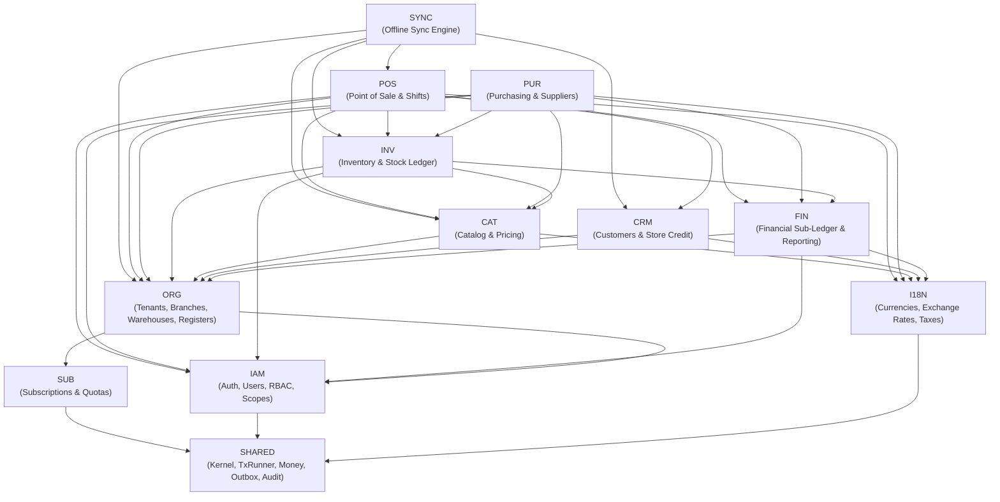

# 03 — Module Boundaries and Dependencies

| Metadata | Details |
| :--- | :--- |
| **Document ID** | `NEX-DOC-03` |
| **Status** | Approved Baseline (Rev 1.1 — UD-01..UD-05 Incorporated) |
| **Principle Addressed** | Principle #1 (Modular Monolith), Principle #2 (Clear Module Boundaries), Principle #11 (Avoid Premature Microservices) |

---

## 1. Modular Monolith Design Philosophy

NexStock is structured as a **Strict Modular Monolith**. All modules run within the same TypeScript API process and share a single PostgreSQL database cluster, but are logically isolated as if they were independent services:

1. **No Cross-Module Table Writes**: A module may **never** execute `INSERT`, `UPDATE`, or `DELETE` on a database table owned by another module.
2. **No Direct Cross-Module Repository Imports**: Module A cannot import internal repositories, domain entities, or SQL schemas from `modules/B/infrastructure/*` or `modules/B/domain/*`.
3. **Public Facade Contract Only**: Cross-module communication is restricted to `modules/<name>/index.ts` (the module's Public Facade / Port) or asynchronous internal domain events via the Transactional Outbox.
4. **Acyclic Dependency Graph (DAG)**: Module dependencies form a strict DAG. Circular dependencies between modules are forbidden and blocked by CI linter rules (`eslint-plugin-boundaries` / `dependency-cruiser`).

---

## 2. Domain Module Catalog

| Module Code | Module Name | Core Responsibility | Owned Database Tables (Exclusive Write Ownership) |
| :--- | :--- | :--- | :--- |
| **`SHARED`** | Kernel & Infrastructure Primitives | Tenant context propagation, DB transaction manager (`withTenantTx`), Money/Quantity value objects, ULID/UUIDv7 generator, RFC 9457 error classes, Outbox dispatcher, Audit log writer. | `outbox_events`, `idempotency_keys`, `audit_logs` |
| **`IAM`** | Identity, Access & RBAC | User profile sync with Supabase Auth, tenant memberships, role definitions, permission grants, branch/warehouse access scopes, supervisor override PIN/token verification. | `users`, `tenant_memberships`, `roles`, `role_permissions`, `member_role_assignments`, `member_location_scopes`, `supervisor_override_logs` |
| **`ORG`** | Organization, Branches & Terminals | Tenant settings, base currency, fiscal configuration, branches, warehouses, branch-warehouse links, storage bins/zones, POS register terminals, device registration. | `tenants`, `branches`, `warehouses`, `branch_warehouse_links`, `warehouse_bins`, `pos_registers`, `registered_devices` |
| **`SUB`** | Subscription & Entitlements | SaaS plans, admin-provisioned tenant subscriptions & trials, quota limits, subscription invoices & payment records, provider-neutral billing port & webhook ingestion. | `subscription_plans`, `tenant_subscriptions`, `subscription_invoices`, `subscription_payments`, `subscription_usage_snapshots`, `billing_webhook_events` |
| **`I18N`** | Currency, Tax & Localization | Supported currencies, tenant exchange rates & historical rate snapshots, tax jurisdictions, tax groups, tax rates, document numbering sequences, locale/receipt templates. | `currencies`, `tenant_exchange_rates`, `tax_groups`, `tax_rates`, `document_sequences`, `receipt_templates` |
| **`CAT`** | Catalog & Pricing | Categories, brands, units of measure (UoM) & conversions, products, product variants, barcodes, composite bundle definitions, price lists, branch price overrides, customer group tiers. | `categories`, `brands`, `units_of_measure`, `uom_conversions`, `products`, `product_variants`, `product_barcodes`, `bundle_components`, `price_lists`, `price_list_items` |
| **`CRM`** | Customers & Loyalty/Credit | Customer profiles, tax registration IDs (B2B VAT/GST), credit limits, store credit ledger, gift cards. | `customers`, `customer_addresses`, `store_credit_accounts`, `store_credit_ledger`, `gift_cards` |
| **`INV`** | Inventory & Stock Ledger | Immutable stock movement ledger, materialized stock balances (`on_hand`, `reserved`, `in_transit`, `damaged`), batch/lot & expiry records, serial numbers, stock reservations, inter-warehouse stock transfers, stocktake sessions, stock adjustments, cost layers (MAC / FIFO). | `stock_ledger_entries`, `inventory_balances`, `inventory_batches`, `inventory_serials`, `stock_reservations`, `stock_transfers`, `stock_transfer_lines`, `stocktake_sessions`, `stocktake_lines`, `stock_adjustments`, `stock_adjustment_lines`, `inventory_cost_layers` |
| **`POS`** | Point of Sale & Shift Management | Cashier shift open/close, cash drawer pay-in/pay-out, cash reconciliation, POS sales orders/invoices, returns & exchanges, payment tender records, parked orders. | `pos_shifts`, `cash_drawer_movements`, `sales_invoices`, `sales_invoice_lines`, `sales_invoice_taxes`, `sales_payments`, `sales_returns`, `sales_return_lines` |
| **`PUR`** | Purchasing & Suppliers | Supplier directory, supplier catalog & lead times, purchase orders (PO), goods receipt notes (GRN), supplier invoices/bills, landed cost allocations, purchase returns (RTV). | `suppliers`, `supplier_products`, `purchase_orders`, `purchase_order_lines`, `goods_receipts`, `goods_receipt_lines`, `supplier_bills`, `landed_cost_vouchers`, `purchase_returns` |
| **`FIN`** | Financial Sub-Ledger & Reporting | Chart of accounts mapping, immutable financial journal entries (Sales, COGS, Inventory Asset, Tax Payable, AP, AR, Cash Clearing, Purchase Price Variance), accounting period locks, pre-aggregated analytical read models (Z-reports, tax summaries). | `ledger_accounts`, `journal_entries`, `journal_entry_lines`, `accounting_periods`, `daily_branch_financial_rollups` |
| **`SYNC`** | Offline Synchronization Engine | Device sync watermarks, delta change feed queries, offline command batch ingestion, per-command idempotency routing, conflict detection & resolution queue. | `sync_device_watermarks`, `sync_command_log`, `sync_conflicts` |

---

## 3. Module Dependency Directed Acyclic Graph (DAG)



### Dependency Direction Rules (Layered Tiers)
To guarantee zero cycles, modules are organized into 5 strict tiers where a module in Tier $N$ may only depend on modules in Tier $< N$ (or declared peer facades within the same tier where explicitly arrow-directed above):

- **Tier 0 (Foundation Kernel)**: `SHARED`
- **Tier 1 (Platform Governance)**: `IAM`, `SUB`, `I18N`, `ORG`
- **Tier 2 (Master Data & Financial Core)**: `CAT`, `CRM`, `FIN`
- **Tier 3 (Core Inventory Engine)**: `INV`
- **Tier 4 (Transactional Flows)**: `POS`, `PUR`
- **Tier 5 (Edge Orchestration)**: `SYNC`

> [!NOTE]
> Notice how `INV` depends on `FIN` (to post inventory valuation / adjustment journal entries via `FIN`'s public facade), while `FIN` does **not** depend on `INV`, `POS`, or `PUR`. Instead, `POS`, `PUR`, and `INV` push balanced sub-ledger postings into `FIN` inside the same database transaction (or via domain events), keeping the dependency graph strictly acyclic.

---

## 4. Inter-Module Interaction Contracts

### 4.1 Synchronous In-Transaction Facade Calls
When a single business operation spans multiple modules and requires immediate ACID atomicity, the orchestrating module opens a tenant-scoped database transaction (`tx`) and passes `tx` into the public facade methods of downstream modules:

**Example: Completing a POS Sale (`POS` → `CAT`, `I18N`, `INV`, `CRM`, `FIN`)**
1. `POS.CompleteSaleUseCase` starts `withTenantTransaction(ctx, async (tx) => { ... })`.
2. Calls `IAM.assertLocationPermission(tx, ctx.userId, branchId, 'pos.sale.create')`.
3. Calls `CAT.resolveLineItemsAndPrices(tx, branchId, items)` to verify active SKUs, UoMs, and prices (or validates offline price snapshot if flagged as an offline-synced command).
4. Calls `I18N.calculateTaxesAndExchangeRate(tx, branchId, currency, lines)` to compute or verify tax breakdown and exchange rate snapshot.
5. Inserts `sales_invoices`, `sales_invoice_lines`, and `sales_payments` (owned by `POS`).
6. Calls `INV.commitSaleStockDeduction(tx, { invoiceId, warehouseId, lines, allowNegativeOffline })` which appends immutable rows to `stock_ledger_entries`, updates `inventory_balances`, and returns the exact **Cost of Goods Sold (COGS)** computed from `inventory_cost_layers`.
7. If paid via Store Credit, calls `CRM.debitStoreCredit(tx, { customerId, amount, invoiceId })`.
8. Calls `FIN.postSubLedgerEntry(tx, { sourceType: 'POS_INVOICE', sourceId: invoiceId, revenue, tax, cogs, tenders })`.
9. Appends `PosSaleCompletedEvent` to `outbox_events` and commits `tx`.

### 4.2 Asynchronous Domain Events (Outbox Pattern)
Used when downstream reactions do not need to block the user's HTTP response or can be eventually consistent:

| Event Name | Producer Module | Consumer Module(s) | Purpose |
| :--- | :--- | :--- | :--- |
| `ProductUpdatedEvent` / `PriceUpdatedEvent` | `CAT` | `SYNC` | Advances catalog change sequence watermark so POS/Mobile devices pull delta updates. |
| `StockBalanceChangedEvent` | `INV` | `SYNC`, Notification Worker | Advances inventory watermark for affected branch/warehouse; triggers low-stock alert checks if `available <= reorder_point`. |
| `GoodsReceiptPostedEvent` | `PUR` | `FIN`, `SYNC` | Updates AP accrual projections and notifies branch devices of newly arrived stock. |
| `PosShiftClosedEvent` | `POS` | `FIN` | Triggers generation of immutable Z-Report snapshot and cash over/short variance journal posting. |
| `SubscriptionStatusChangedEvent` | `SUB` | `ORG`, `IAM` | Updates cached tenant entitlement state; revokes write capabilities if tenant transitions to `SUSPENDED`. |

### 4.3 Provider-Neutral Subscription Billing Port (`UD-05`)
To ensure zero payment-gateway lock-in for the initial release while allowing seamless future integration with regional or global gateways:
- The `SUB` module defines a strict server-side outbound port (`SubscriptionBillingPort`):
  ```typescript
  export interface SubscriptionBillingPort {
    readonly providerCode: 'MANUAL_ADMIN' | 'PAYHERE_LK' | 'STRIPE' | 'PADDLE';
    createBillingSession?(input: CreateBillingSessionInput): Promise<BillingSessionResult>;
    verifyAndParseWebhook?(headers: Record<string, string>, rawBody: Buffer): Promise<NormalizedBillingWebhookEvent>;
    cancelExternalSubscription?(externalSubscriptionId: string): Promise<void>;
  }
  ```
- **Initial Release Adapter (`ManualAdminBillingAdapter`)**: Supports admin-provisioned trials, plan assignments, generated `subscription_invoices`, and manual/recorded `subscription_payments` (`BANK_TRANSFER`, `CHEQUE`, `CASH_RECEIPT`, `EXTERNAL_REF`) with full auditability.
- **Future Gateway Readiness (Sri Lanka & Global)**: Any future automated gateway adapter must live exclusively inside `modules/sub/infrastructure/providers/` with API keys and HMAC webhook verification kept strictly server-side, after verifying Sri Lankan legal entity eligibility, Central Bank of Sri Lanka (CBSL) / foreign exchange compliance, LKR & USD settlement support, payout schedules, and transaction fees.

---

## 5. Boundary Enforcement Strategy

To prevent architectural erosion over time:
1. **Directory Convention**:
   ```text
   apps/api/src/modules/<module-name>/
   ├── index.ts              # ONLY file allowed to be imported by other modules
   ├── http/                 # Fastify/Nest controllers & route schemas (internal)
   ├── application/          # Use cases & command handlers (internal)
   ├── domain/               # Entities, value objects, domain rules (internal)
   └── infrastructure/       # SQL repositories & row mappers (internal)
   ```
2. **Automated Linter Rule (`eslint-plugin-boundaries`)**:
   - Any import matching `modules/*/domain/**`, `modules/*/infrastructure/**`, or `modules/*/application/**` from outside that module triggers a build-breaking lint error.
   - Any import that violates the Tier 0 → Tier 5 DAG triggers a build-breaking lint error.
3. **Database Schema Namespace / Table Ownership Check**:
   - Every table migration or schema file is declared inside its owning module's `infrastructure/schema.ts`. A CI static check verifies that SQL queries in Module X only perform DML (`INSERT`/`UPDATE`/`DELETE`) on tables declared in Module X.
