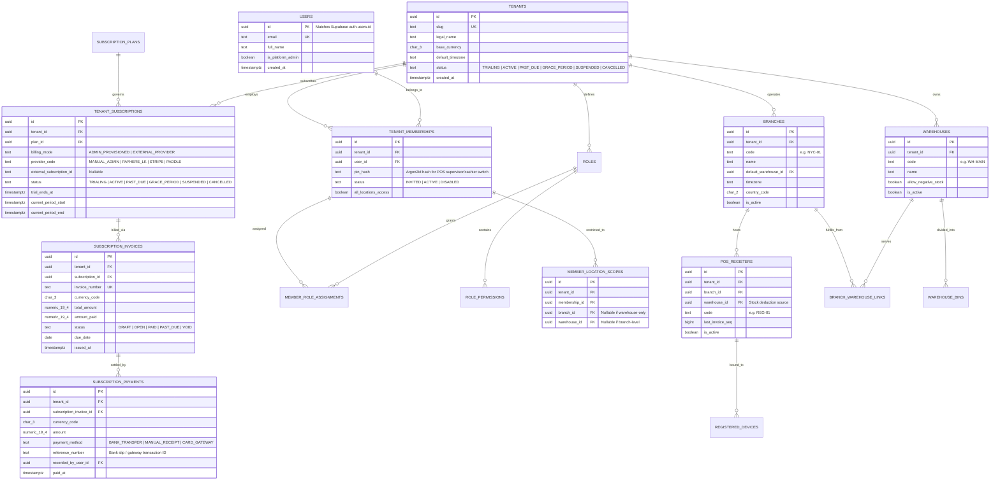
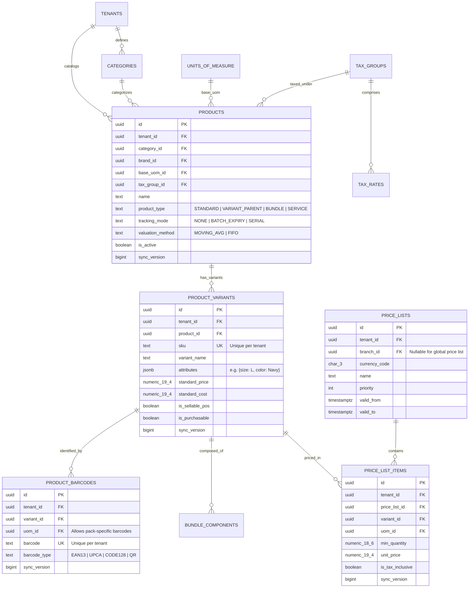
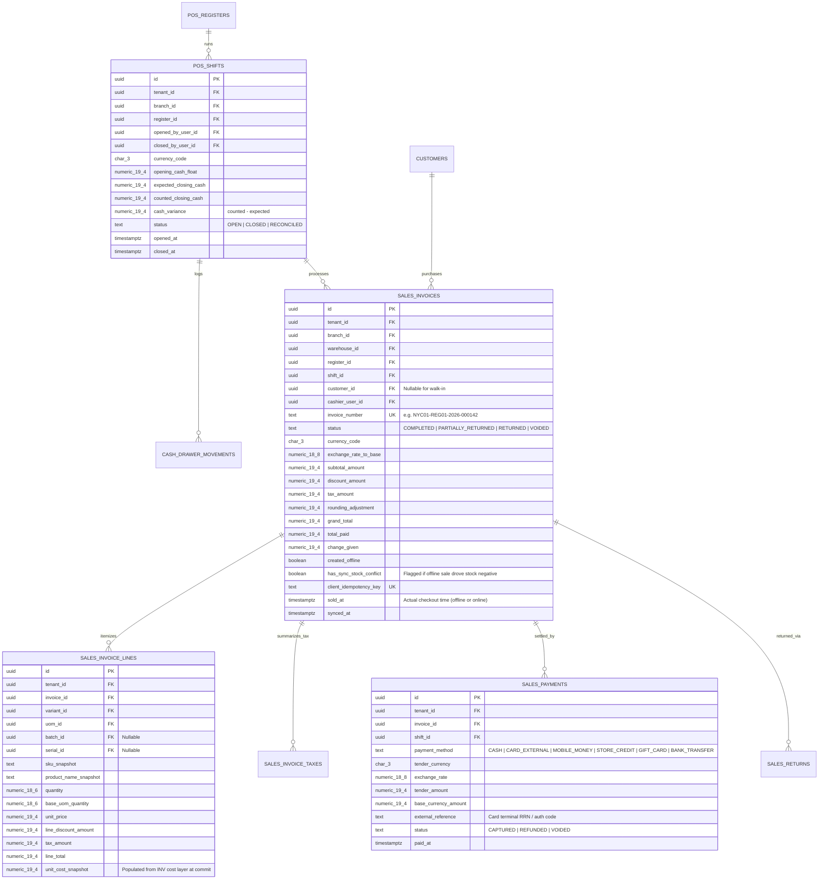
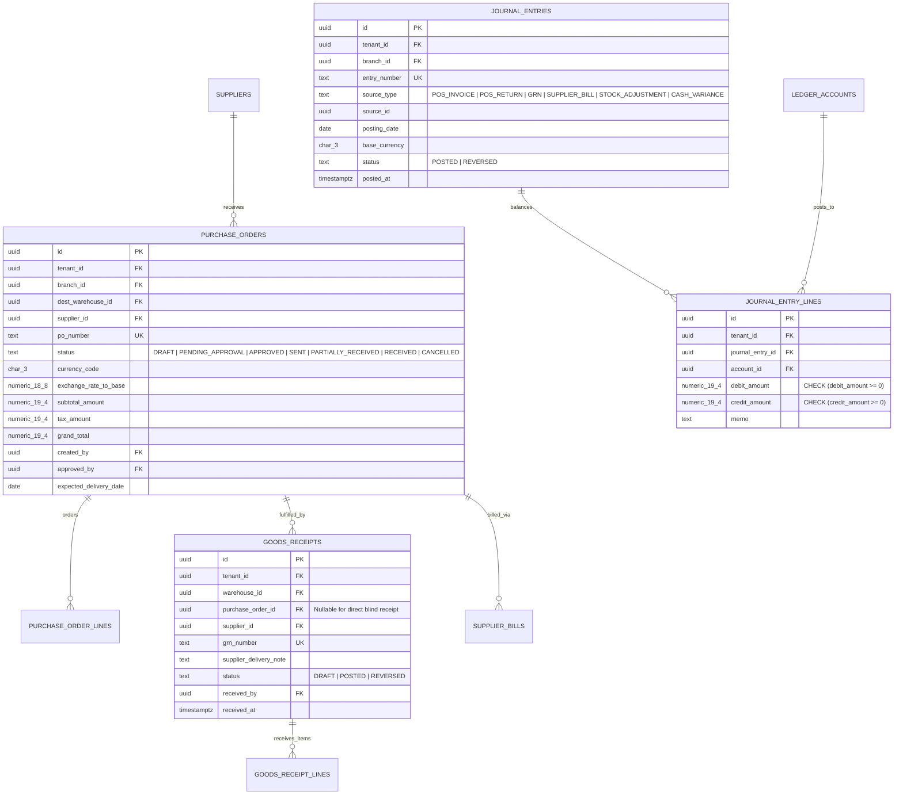

# 04 — Database Entity Relationship Design (ERD)

| Metadata | Details |
| :--- | :--- |
| **Document ID** | `NEX-DOC-04` |
| **Status** | Approved Baseline (Rev 1.1 — UD-01..UD-05 Incorporated) |
| **Target DBMS** | PostgreSQL 16+ (Cloud Source of Truth) & SQLite 3.37+ `STRICT` (Offline Edge Subset) |
| **Constraint Note** | No database migration files are created at this stage per project constraints. |

---

## 1. Core Database Design Conventions

1. **Primary Keys (`id`)**:
   - All primary keys use **`UUID`** storing **UUIDv7** (time-ordered UUIDs, RFC 9562).
   - **Why UUIDv7?** Unlike random UUIDv4 (which causes severe B-tree page fragmentation on high-volume ledger inserts) or `BIGSERIAL` (which cannot be generated offline without collisions), UUIDv7 is 100% compatible with PostgreSQL's native `uuid` 16-byte type, chronologically sortable, and safely generated offline by POS terminals and mobile devices.
2. **Tenant Isolation Key (`tenant_id`)**:
   - **Every** tenant-scoped table—including child line-item tables (`sales_invoice_lines`, `stock_ledger_entries`, `journal_entry_lines`)—explicitly carries `tenant_id UUID NOT NULL`.
   - **Why denormalize `tenant_id` onto child tables?** PostgreSQL Row Level Security (RLS) policies on child tables can evaluate `tenant_id = current_tenant_id()` via a direct composite index scan without executing expensive parent-table `JOIN`s on every row read/write.
3. **Composite Foreign Keys for Cross-Tenant Integrity**:
   - All foreign keys between tenant-scoped tables include `tenant_id`, e.g., `FOREIGN KEY (tenant_id, branch_id) REFERENCES branches (tenant_id, id)`. This makes it mathematically impossible at the database constraint level for a row in Tenant A to reference a branch, product, or warehouse belonging to Tenant B.
4. **Monetary & Quantity Precision**:
   - Monetary amounts: `NUMERIC(19, 4)` in PostgreSQL (supporting both 2-decimal currencies like USD/EUR, 3-decimal currencies like KWD/BHD, and 4-decimal unit cost precision), paired with `currency_code CHAR(3)` and `exchange_rate NUMERIC(18, 8)`.
   - Inventory quantities: `NUMERIC(18, 6)` to support fractional weights, lengths, and UoM conversions without rounding drift.
5. **Sync & Audit Metadata Columns**:
   - Master and transactional tables include:
     - `created_at TIMESTAMPTZ NOT NULL DEFAULT clock_timestamp()`
     - `updated_at TIMESTAMPTZ NOT NULL DEFAULT clock_timestamp()`
     - `sync_version BIGINT NOT NULL` (populated from a monotonic sequence per tenant/table change feed for delta sync)
     - `deleted_at TIMESTAMPTZ NULL` (soft delete for master data; ledger tables never allow delete).

---

## 2. Entity Relationship Diagrams by Domain

### 2.1 Tenant, IAM, Organization & Subscriptions (`ORG`, `IAM`, `SUB`)

---

### 2.2 Catalog, Pricing, Tax & Multi-Currency (`CAT`, `I18N`)

---

### 2.3 Advanced Inventory & Immutable Stock Ledger (`INV`)

```mermaid
erDiagram
    WAREHOUSES ||--o{ INVENTORY_BALANCES : "holds"
    PRODUCT_VARIANTS ||--o{ INVENTORY_BALANCES : "quantified_in"
    WAREHOUSES ||--o{ STOCK_LEDGER_ENTRIES : "records"
    PRODUCT_VARIANTS ||--o{ STOCK_LEDGER_ENTRIES : "tracks"
    INVENTORY_BATCHES ||--o{ STOCK_LEDGER_ENTRIES : "lot_tracked"
    INVENTORY_BATCHES ||--o{ INVENTORY_COST_LAYERS : "costed_via"
    INVENTORY_SERIALS ||--o{ STOCK_LEDGER_ENTRIES : "serial_tracked"
    STOCK_TRANSFERS ||--o{ STOCK_TRANSFER_LINES : "contains"
    STOCKTAKE_SESSIONS ||--o{ STOCKTAKE_LINES : "captures"
    STOCK_ADJUSTMENTS ||--o{ STOCK_ADJUSTMENT_LINES : "adjusts"

    STOCK_LEDGER_ENTRIES {
        uuid id PK "UUIDv7 strictly chronological"
        uuid tenant_id FK
        uuid warehouse_id FK
        uuid bin_id FK "Nullable"
        uuid variant_id FK
        uuid batch_id FK "Nullable"
        uuid serial_id FK "Nullable"
        text movement_type "PURCHASE_RECEIPT | POS_SALE | POS_RETURN | PURCHASE_RETURN | TRANSFER_OUT | TRANSFER_IN | ADJUSTMENT_GAIN | ADJUSTMENT_LOSS | DAMAGE_WRITEOFF | COST_REVALUATION"
        text reference_type "POS_INVOICE | POS_RETURN | GRN | SUPPLIER_BILL | LANDED_COST | STOCK_TRANSFER | STOCK_ADJUSTMENT"
        uuid reference_id
        uuid reference_line_id
        numeric_18_6 qty_delta "Signed: +in / -out in base UoM (0 for pure COST_REVALUATION)"
        numeric_18_6 balance_after "Snapshot of warehouse on_hand after entry"
        numeric_19_4 unit_cost "Base currency cost per base UoM"
        numeric_19_4 total_cost_delta "Signed Inventory Asset valuation delta"
        uuid actor_user_id FK
        uuid device_id FK "Nullable"
        text idempotency_key UK "Unique per tenant"
        timestamptz occurred_at "Client/event timestamp"
        timestamptz recorded_at "Server commit timestamp"
    }

    INVENTORY_BALANCES {
        uuid id PK
        uuid tenant_id FK
        uuid warehouse_id FK
        uuid variant_id FK
        numeric_18_6 qty_on_hand "Updated ONLY alongside stock_ledger_entries insert"
        numeric_18_6 qty_reserved
        numeric_18_6 qty_in_transit
        numeric_18_6 qty_damaged
        numeric_19_4 moving_avg_cost "Authoritative unit cost for MAC items; weighted summary for FIFO"
        numeric_19_4 total_inventory_value "Exact asset valuation on_hand in base currency"
        numeric_18_6 reorder_point
        numeric_18_6 reorder_qty
        uuid last_ledger_entry_id FK
        bigint sync_version
    }

    INVENTORY_COST_LAYERS {
        uuid id PK "UUIDv7 chronological FIFO order"
        uuid tenant_id FK
        uuid warehouse_id FK
        uuid variant_id FK
        uuid batch_id FK "Required for BATCH_EXPIRY FIFO layers"
        uuid source_ledger_entry_id FK
        numeric_18_6 initial_qty
        numeric_18_6 remaining_qty "CHECK (remaining_qty >= 0)"
        numeric_19_4 unit_cost "Updated only on remaining_qty if landed cost applied"
        boolean is_exhausted
        timestamptz received_at
    }

    INVENTORY_BATCHES {
        uuid id PK
        uuid tenant_id FK
        uuid warehouse_id FK
        uuid variant_id FK
        text batch_number
        date manufactured_date
        date expiry_date
        numeric_18_6 qty_on_hand
        numeric_19_4 unit_cost
    }

    INVENTORY_SERIALS {
        uuid id PK
        uuid tenant_id FK
        uuid variant_id FK
        uuid current_warehouse_id FK "Nullable once sold"
        uuid batch_id FK "Nullable"
        text serial_number UK "Unique per (tenant_id, variant_id, serial_number)"
        text status "IN_STOCK | RESERVED | IN_TRANSIT | SOLD | RETURNED_DEFECTIVE"
    }

    STOCK_TRANSFERS {
        uuid id PK
        uuid tenant_id FK
        text transfer_number UK
        uuid source_warehouse_id FK
        uuid dest_warehouse_id FK
        text status "DRAFT | APPROVED | IN_TRANSIT | PARTIALLY_RECEIVED | RECEIVED | CANCELLED"
        uuid dispatched_by FK
        uuid received_by FK
        timestamptz dispatched_at
        timestamptz received_at
    }
```

> [!IMPORTANT]
> **Database-Enforced Stock Ledger Invariant**:
> `stock_ledger_entries` has a PostgreSQL `BEFORE UPDATE OR DELETE` trigger that raises an exception (`Stock ledger entries are strictly immutable`). Corrections are exclusively performed via compensating reversal/adjustment entries. Furthermore, `inventory_balances.qty_on_hand` is maintained atomically inside the same transaction that inserts into `stock_ledger_entries` using row-level locking (`SELECT ... FROM inventory_balances WHERE tenant_id = $1 AND warehouse_id = $2 AND variant_id = $3 FOR UPDATE`).

---

### 2.4 Point of Sale (POS), Shifts & Payments (`POS`)

---

### 2.5 Purchasing, Suppliers & Financial Sub-Ledger (`PUR`, `FIN`)

> [!IMPORTANT]
> **Double-Entry Financial Invariant**:
> Every `journal_entries` record is committed via a deferred constraint trigger (or application use-case check + DB constraint) verifying that `SUM(debit_amount) = SUM(credit_amount)` across its `journal_entry_lines` and that `(debit_amount > 0 AND credit_amount = 0) OR (credit_amount > 0 AND debit_amount = 0)`.

---

## 3. Critical Indexing & Partitioning Strategy

| Table | Index Definition | Purpose |
| :--- | :--- | :--- |
| **All Tenant Tables** | `(tenant_id, id)` UNIQUE | Enables composite foreign keys and zero-join RLS filtering. |
| `product_barcodes` | `(tenant_id, barcode)` UNIQUE | Instant barcode lookup (`< 5 ms`). |
| `product_variants` | `(tenant_id, sku)` UNIQUE & `(tenant_id, sync_version)` | SKU lookup & incremental delta sync queries. |
| `inventory_balances` | `(tenant_id, warehouse_id, variant_id)` UNIQUE | Point-in-time balance locking & lookup. |
| `stock_ledger_entries` | `(tenant_id, warehouse_id, variant_id, id DESC)` | Fast chronological stock card / movement audit queries. |
| `sales_invoices` | `(tenant_id, branch_id, sold_at DESC)` & `(tenant_id, client_idempotency_key)` UNIQUE | Branch sales reporting & duplicate offline submission prevention. |
| `outbox_events` | `(status, created_at) WHERE status = 'PENDING'` | Partial index for zero-bloat outbox polling. |

### Table Partitioning Plan
- `stock_ledger_entries`, `journal_entry_lines`, and `audit_logs` are designed to be **range-partitioned by `recorded_at` / `created_at` (monthly or quarterly partitions)** once volume scales, keeping working-set indexes in RAM while preserving historical partitions for 7-year compliance audits.

---

## 4. Inventory Valuation, Costing Rules & Accounting Implications (`UD-03`)

Per **UD-03**, NexStock enforces a deterministic, auditable inventory costing and sub-ledger accounting model where **historical posted transactions (`stock_ledger_entries`, `sales_invoice_lines`, `journal_entries`) are strictly immutable and never retroactively rewritten**.

### 4.1 Valuation Method Assignment Rules
- **Standard & Serialized Inventory (`tracking_mode IN ('NONE', 'SERIAL')`)**: Always valued via **Moving Average Cost (MAC)** per `(tenant_id, warehouse_id, variant_id)`.
- **Batch / Lot-Tracked Inventory (`tracking_mode = 'BATCH_EXPIRY'`)**: Always valued via **FIFO Cost Layers** (`inventory_cost_layers`) linked to `batch_id` (or FEFO/specific batch selection when a specific batch barcode is scanned at POS/dispatch).
- **Immutability of Valuation Mode**: A product's `valuation_method` (`MOVING_AVG` vs. `FIFO`) cannot be changed once any `stock_ledger_entries` exist for that product.

### 4.2 Moving Average Cost (MAC) Mathematical Rules
For each `(tenant_id, warehouse_id, variant_id)` row in `inventory_balances`:
1. **Standard Positive Receipt (`qty_on_hand >= 0` before receipt of $+Q_{\text{in}}$ at unit cost $C_{\text{in}}$)**:
   $$\text{New MAC} = \text{Round}_{4}\!\left(\frac{(Q_{\text{on\_hand}} \times \text{MAC}_{\text{old}}) + (Q_{\text{in}} \times C_{\text{in}})}{Q_{\text{on\_hand}} + Q_{\text{in}}}\right)$$
   $$\text{total\_inventory\_value}_{\text{new}} = \text{total\_inventory\_value}_{\text{old}} + \text{Round}_{4}(Q_{\text{in}} \times C_{\text{in}})$$
2. **Sale / Outbound Issue ($-Q_{\text{out}}$)**:
   - Issued at current $\text{MAC}_{\text{old}}$.
   - $\text{COGS} = \text{Round}_{4}(Q_{\text{out}} \times \text{MAC}_{\text{old}})$.
   - When $Q_{\text{on\_hand}}$ reaches exactly $0$, $\text{total\_inventory\_value}$ is set to $0.0000$ (any sub-cent rounding residual $\le \$0.01$ is absorbed into the final unit's `total_cost_delta` so zero stock always equals zero asset value), while $\text{MAC}$ retains its last known positive unit cost as a fallback reference.
3. **Receipt Recovering from Negative Stock (`qty_on_hand < 0` due to Offline POS Sync)**:
   - While $Q_{\text{on\_hand}} < 0$, outbound sales were booked at the last known $\text{MAC}_{\text{old}}$.
   - When a new purchase receipt of $+Q_{\text{in}}$ arrives at cost $C_{\text{in}}$:
     - Let $Q_{\text{deficit}} = \min(Q_{\text{in}}, |Q_{\text{on\_hand}}|)$ be the portion of the receipt that covers the negative balance, and $Q_{\text{surplus}} = \max(0, Q_{\text{in}} - |Q_{\text{on\_hand}}|)$ be the remaining positive stock.
     - Historical POS sales that caused the negative stock are **not** retroactively altered.
     - Instead, any cost difference on the deficit quantity, $\Delta_{\text{neg}} = Q_{\text{deficit}} \times (C_{\text{in}} - \text{MAC}_{\text{old}})$, is immediately posted in the **current open period** to **COGS / Negative Inventory Price Variance** (`Dr/Cr COGS Variance`, `Cr/Dr Inventory Asset`), and if $Q_{\text{surplus}} > 0$, the new $\text{MAC}$ becomes $C_{\text{in}}$ with $\text{total\_inventory\_value} = Q_{\text{surplus}} \times C_{\text{in}}$.

### 4.3 FIFO Cost Layer Rules (Batch / Lot Inventory)
1. **Layer Creation**: Every `PURCHASE_RECEIPT`, `TRANSFER_IN`, or positive `ADJUSTMENT_GAIN` on a batch-tracked item inserts a row into `inventory_cost_layers` with `initial_qty = remaining_qty = Q_in` and `unit_cost = C_in`.
2. **Layer Consumption**:
   - If the POS sale or warehouse dispatch specifies an explicit `batch_id`, layers for that `batch_id` are consumed in chronological `(received_at ASC, id ASC)` order (`SELECT ... FOR UPDATE`).
   - If a sale spans multiple cost layers (e.g., 3 units from Layer 1 at $\$10.00$ and 2 units from Layer 2 at $\$11.00$), `INV` deducts from both layers and records the exact weighted COGS $(\$30.00 + \$22.00 = \$52.00$, effective `unit_cost_snapshot` $= \$10.4000$) on the `stock_ledger_entries` and `sales_invoice_lines` records.

### 4.4 Customer Sales Returns & Supplier Purchase Returns (RTV)
1. **Customer Return (`POS_RETURN`)**:
   - **Referenced Return (`RESTOCK_SELLABLE`)**: Restores stock at the **exact `unit_cost_snapshot` captured on the original `sales_invoice_lines`**.
     - For MAC items: Treated as an inbound receipt of $+Q_{\text{ret}}$ at $C_{\text{orig\_sale\_cost}}$, recalculating MAC.
     - For FIFO Batch items: Creates or replenishes the batch cost layer at $C_{\text{orig\_sale\_cost}}$.
   - **Unreferenced Return (`RESTOCK_SELLABLE`)**: Restores stock at current warehouse `moving_avg_cost` (or `standard_cost` if `moving_avg_cost = 0`).
   - **Damaged Return (`WRITE_OFF_DAMAGED`)**: Increments `qty_damaged` (non-sellable), reverses `Sales Revenue` and `Tax Payable`, and reclassifies the original COGS to `Damaged Inventory Write-Off Expense` without inflating sellable `Inventory Asset`.
2. **Purchase Return to Vendor (`PURCHASE_RETURN` / RTV)**:
   - Deducts stock at the linked GRN/Bill cost $C_{\text{grn}}$.
   - If the current MAC or remaining layer value differs from $C_{\text{grn}}$, the inventory asset is credited by $Q_{\text{rtv}} \times \text{MAC}_{\text{current}}$ and any difference against the supplier debit note $Q_{\text{rtv}} \times C_{\text{grn}}$ is posted to `Purchase Price Variance (PPV)`.

### 4.5 Purchase-Cost Adjustments & Landed Cost Allocations (Non-Retroactive Rule)
Often, a Goods Receipt Note (`GRN`) is posted on Monday (100 units at PO price $\$10.00$), 40 units are sold on Tuesday, and on Wednesday the Supplier Bill or Customs Freight Landed Cost Voucher arrives adding $+\$200.00$ ($\$2.00/\text{unit}$) to the shipment cost.

**Strict Non-Retroactive Accounting Rule**:
- Tuesday's posted POS sales and closed shifts are **never modified**.
- At the moment the Supplier Bill variance or Landed Cost Voucher is posted on Wednesday, the system inspects how many units from that GRN remain in stock ($Q_{\text{rem}} = 60$) versus how many have already left stock ($Q_{\text{sold}} = 40$):
  1. **Capitalized Portion ($60\% = \$120.00$)**: Appends a `COST_REVALUATION` entry (`qty_delta = 0`, `total_cost_delta = +120.0000`) to `stock_ledger_entries`, increasing `inventory_balances.total_inventory_value` by $+\$120.00$ and updating `moving_avg_cost` (or `inventory_cost_layers.unit_cost` for the remaining 60 units).
  2. **Expensed Portion ($40\% = \$80.00$)**: Posts directly to **COGS / Purchase Price Variance (`PPV`)** in Wednesday's open accounting period.

### 4.6 Canonical Double-Entry Sub-Ledger Posting Matrix (`FIN`)

Every inventory and POS event generates balanced `journal_entry_lines` (`SUM(debit) = SUM(credit)`):

| Business Event | Debit (`Dr`) Account(s) | Credit (`Cr`) Account(s) | Valuation Basis |
| :--- | :--- | :--- | :--- |
| **1. Goods Receipt (`GRN`)** | `1300 Inventory Asset` | `2110 Goods Received Not Invoiced (GRNI)` | PO / GRN Unit Cost $\times Q_{\text{rec}}$ |
| **2. Supplier Bill Matched to GRN (With Cost / Landed Variance)** | `2110 GRNI Clearing` `1300 Inventory Asset` (for $Q_{\text{rem}}$ share) `5150 Purchase Price Variance / COGS Adj` (for $Q_{\text{sold}}$ share) | `2100 Accounts Payable (AP)` | Bill Total vs. GRNI Accrual |
| **3. POS Sale Completed (`POS_INVOICE`)** | `1010 Cash on Hand / Register Drawer` (or `1020 Card Clearing`) `5100 Cost of Goods Sold (COGS)` | `4000 Sales Revenue` (net) `2200 Sales Tax Payable` `1300 Inventory Asset` | Invoice Tender + MAC/FIFO COGS Snapshot |
| **4. POS Return (`RESTOCK_SELLABLE`)** | `4050 Sales Returns & Allowances` `2200 Sales Tax Payable` `1300 Inventory Asset` | `1010 Cash / Refund Tender` `5100 Cost of Goods Sold (COGS)` | Original Invoice `unit_cost_snapshot` |
| **5. POS Return (`WRITE_OFF_DAMAGED`)** | `4050 Sales Returns & Allowances` `2200 Sales Tax Payable` `5200 Damaged Stock Write-Off Expense` | `1010 Cash / Refund Tender` `5100 Cost of Goods Sold (COGS)` | Original Invoice `unit_cost_snapshot` |
| **6. Inter-Warehouse Transfer Dispatch (`TRANSFER_OUT`)** | `1310 Inventory In-Transit Asset` | `1300 Inventory Asset (Source Whse)` | Source Whse MAC / FIFO Layer Cost |
| **7. Inter-Warehouse Transfer Receipt (`TRANSFER_IN`)** | `1300 Inventory Asset (Dest Whse)` | `1310 Inventory In-Transit Asset` | Exact Dispatched Transfer Cost |
| **8. Stock Adjustment Gain / Loss** | Gain: `1300 Inventory Asset` Loss: `5210 Inventory Shrinkage Expense` | Gain: `5210 Inventory Shrinkage` Loss: `1300 Inventory Asset` | Current Whse MAC / Layer Cost |

### 4.7 Core Inventory Valuation Invariants (Verified in CI)
1. **Ledger-to-Balance Quantity Invariant**:
   $$\forall (\text{tenant}, \text{warehouse}, \text{variant}): \quad \text{inventory\_balances.qty\_on\_hand} = \sum \text{stock\_ledger\_entries.qty\_delta}$$
2. **Ledger-to-Balance Asset Value Invariant**:
   $$\forall (\text{tenant}, \text{warehouse}, \text{variant}): \quad \text{inventory\_balances.total\_inventory\_value} = \sum \text{stock\_ledger\_entries.total\_cost\_delta}$$
3. **FIFO Layer Reconciliation Invariant**:
   For all `BATCH_EXPIRY` variants with `qty_on_hand > 0`:
   $$\text{inventory\_balances.qty\_on\_hand} = \sum_{\text{active layers}} \text{remaining\_qty}, \quad \text{total\_inventory\_value} = \sum_{\text{active layers}} \text{Round}_{4}(\text{remaining\_qty} \times \text{unit\_cost})$$
4. **Closed Accounting Period Immutability**:
   No `stock_ledger_entries` or `journal_entries` may be inserted with a `posting_date` falling inside an `accounting_periods` record where `status = 'LOCKED'`. Transactions occurring after period lock post to the earliest open period while preserving their historical `occurred_at` metadata.
