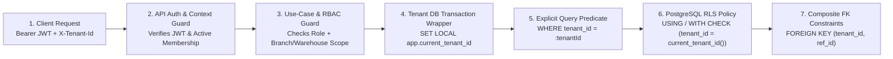

# 05 — Multi-Tenant Security Model

| Metadata | Details |
| :--- | :--- |
| **Document ID** | `NEX-DOC-05` |
| **Status** | Approved Baseline (Rev 1.1 — UD-01..UD-05 Incorporated) |
| **Principle Addressed** | Principle #4 (Server Authorization), Principle #5 (Strict Tenant Isolation) |

---

## 1. Multi-Tenancy Model Selection

NexStock uses a **Shared Database, Shared Schema, Discriminator Column (`tenant_id`) with Enforced PostgreSQL Row Level Security (RLS)** architecture.

### Why Shared Schema + Enforced RLS?
1. **Operational Scalability**: Managing thousands of separate PostgreSQL databases or schemas (`schema-per-tenant`) introduces severe connection pool exhaustion, slow schema migrations across thousands of namespaces, and high infrastructure cost for SMB/Mid-market SaaS tiers.
2. **Zero-Trust Database Layer**: Traditional shared-schema apps rely solely on developers remembering to append `WHERE tenant_id = ?` to every query. A single forgotten `WHERE` clause leaks cross-tenant data. By enforcing **PostgreSQL RLS at the database engine level**, even a buggy query without a `WHERE` clause cannot read or mutate another tenant's rows.
3. **Enterprise Isolation Option**: Because every table includes `tenant_id` and composite foreign keys, high-tier Enterprise customers requiring dedicated physical database residency in the future can be deployed onto a dedicated PostgreSQL instance using the exact same codebase and schema without code changes.

---

## 2. Defense-in-Depth Isolation Layers



### Layer 1 & 2: API Context & Membership Verification
- Every tenant-scoped endpoint requires a verified Supabase JWT and resolves the active `tenant_id` (either embedded in verified `app_metadata.active_tenant_id` or passed via `X-Tenant-Id` header and verified against `tenant_memberships` where `status = 'ACTIVE'`).
- A user who belongs to two tenants (e.g., an external accountant managing two businesses) operates under one explicit `tenant_id` per request.

### Layer 3: Location Scope Enforcement (Branch / Warehouse Isolation)
- Within a single tenant, data access is further restricted by **Location Scope** (`member_location_scopes`):
  - If `tenant_memberships.all_locations_access = false`, the user may only read or mutate operational records (POS shifts, invoices, stock adjustments, transfers) for branches/warehouses explicitly listed in their `member_location_scopes`.

### Layer 4: Connection-Pool Safe PostgreSQL Session Context (`SET LOCAL`)
When using connection pooling (`pg.Pool` or PgBouncer in transaction pooling mode), session-level `SET app.current_tenant_id = '...'` is **dangerous** because the variable persists on the connection after it returns to the pool.

To eliminate connection-pool context bleeding:
1. The TypeScript API connects using a dedicated PostgreSQL role `nexstock_app_user` configured with:
   ```sql
   CREATE ROLE nexstock_app_user LOGIN PASSWORD '...' NOSUPERUSER NOCREATEDB NOCREATEROLE NOBYPASSRLS;
   ```
2. **All** tenant database access in **Kysely (`UD-01`)** must go through `withTenantTransaction(ctx, async (trx) => { ... })`, which pins a single pooled connection inside an explicit database transaction and executes `set_config` with `is_local = true`:
   ```typescript
   export async function withTenantTransaction<T>(
     db: Kysely<Database>,
     ctx: TenantExecutionContext,
     fn: (trx: TenantTransaction<Database>) => Promise<T>,
   ): Promise<T> {
     return db.transaction().execute(async (trx) => {
       await sql`
         SELECT
           set_config('app.current_tenant_id', ${ctx.tenantId}, true),
           set_config('app.current_user_id', ${ctx.userId}, true),
           set_config('app.is_platform_admin', 'false', true)
       `.execute(trx);

       return fn(trx as TenantTransaction<Database>);
     });
   }
   ```
   Because the third argument to `set_config` is `true` (`is_local`), PostgreSQL automatically resets these settings the moment the Kysely transaction commits or rolls back.

### Layer 5 & 6: Fail-Closed PostgreSQL RLS Policies
Every tenant-scoped table has both `ENABLE ROW LEVEL SECURITY` and `FORCE ROW LEVEL SECURITY` enabled.

A helper SQL function retrieves the active tenant and fails closed (returns `NULL`, matching zero rows) if not set:
```sql
CREATE OR REPLACE FUNCTION app_current_tenant_id() RETURNS uuid
LANGUAGE sql STABLE AS $$
  SELECT NULLIF(current_setting('app.current_tenant_id', true), '')::uuid;
$$;
```

Standard policy applied to every tenant table `<table_name>`:
```sql
ALTER TABLE <table_name> ENABLE ROW LEVEL SECURITY;
ALTER TABLE <table_name> FORCE ROW LEVEL SECURITY;

CREATE POLICY tenant_isolation_policy ON <table_name>
  AS PERMISSIVE
  FOR ALL
  TO nexstock_app_user
  USING (tenant_id = app_current_tenant_id())
  WITH CHECK (tenant_id = app_current_tenant_id());
```
> [!NOTE]
> **PostgreSQL RLS Permissive vs. Restrictive Semantics (Verified in Milestone 0)**:
> In PostgreSQL, if no `PERMISSIVE` policy exists on an RLS-enabled table, all rows are denied by default (`false AND restrictive_policy` is always `false`). Therefore, the mandatory base `tenant_isolation_policy` must be `AS PERMISSIVE` (the sole permissive policy on the table), and any additional optional policies (such as branch/location-scope filters added in later modules) are layered as `AS RESTRICTIVE` so PostgreSQL evaluates `tenant_isolation_policy AND location_scope_policy`.
- **`USING` clause**: Filters `SELECT`, `UPDATE`, and `DELETE` rows so rows from other tenants are invisible.
- **`WITH CHECK` clause**: Rejects `INSERT` or `UPDATE` statements attempting to write a `tenant_id` different from `app_current_tenant_id()`.
- **Fail-Closed Default**: If a developer accidentally runs a query outside `withTenantContext()`, `app_current_tenant_id()` returns `NULL`, `tenant_id = NULL` evaluates to `UNKNOWN/FALSE`, and zero rows are returned or mutated.

### Layer 7: Composite Foreign Key Constraints
Even if RLS were bypassed during an administrative migration script, composite foreign keys (`FOREIGN KEY (tenant_id, product_id) REFERENCES products(tenant_id, id)`) ensure that no child row can ever point to a parent entity in another tenant.

---

## 3. Background Jobs & Outbox Multi-Tenant Security

Background workers (e.g., Outbox Dispatcher, Report Generator, Low-Stock Evaluator) do not have an incoming HTTP request, which makes them a common source of multi-tenant bugs.
- Every `outbox_events` row and background job payload **must** store `tenant_id UUID NOT NULL`.
- When the Outbox Worker picks up an event, it constructs a `TenantExecutionContext` for that specific `event.tenant_id` and executes the handler inside `withTenantContext(event.tenant_id, tx => ...)`, subject to the exact same `NOBYPASSRLS` policies as HTTP requests.

---

## 4. Object Storage & Export Isolation

For product images, supplier invoice attachments, PDF receipts, and CSV financial exports:
- **Storage Path Prefixing**: Every object key is strictly prefixed by tenant and module:
  `tenants/{tenant_id}/{module}/{year}/{month}/{uuidv7_filename}`
- **No Public Buckets for Business Documents**: Receipts, invoices, and financial exports live in private buckets. Access is granted exclusively via short-lived (e.g., 5-minute TTL) pre-signed URLs generated by the TypeScript Backend API after verifying the caller's `tenant_id` and RBAC permission.

---

## 5. Offline Device Tenant Binding & Wipe Policy

Because Desktop (Tauri) and Mobile (Flutter) clients store a local SQLite database containing catalog, pricing, and local POS sales:
1. **Single-Tenant Local DB Binding**: A local SQLite database file on a device is bound to a **single `tenant_id` and `device_id`** stored in a local `device_metadata` table.
2. **Tenant Switch / Device Reassignment**: If a user logs out and logs in under a *different* `tenant_id` on the same device:
   - If the local Outbox (`local_sync_outbox`) contains unsynced offline mutations for Tenant A, the client **blocks** switching to Tenant B until Tenant A's outbox is synced (or an admin explicitly authorizes a local backup export + wipe).
   - Once safe, switching tenants rotates/deletes the local SQLite file (`nexstock_{tenant_id}.db`) so two tenants' records never coexist in the same local SQLite database.
3. **Database Encryption at Rest (Recommended)**: For Desktop and Mobile devices operating in field environments, use **SQLCipher** (encrypted SQLite) with the encryption key stored in the OS Secure Enclave / Keychain (macOS Keychain, Windows DPAPI/Credential Manager, iOS Keychain, Android Keystore).
