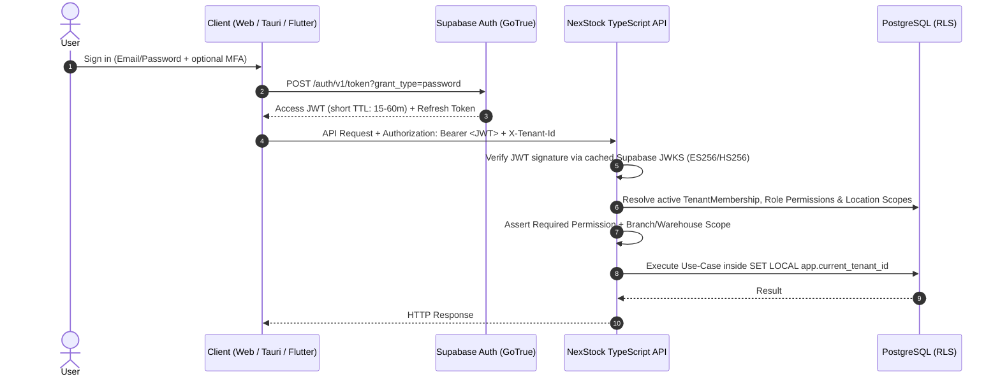

# 06 — Authentication and Authorization Strategy

| Metadata | Details |
| :--- | :--- |
| **Document ID** | `NEX-DOC-06` |
| **Status** | Approved Baseline (Rev 1.1 — UD-01..UD-05 Incorporated) |
| **Principle Addressed** | Principle #3 (No Business Rules in UI), Principle #4 (Enforce Authorization on Server) |

---

## 1. Authentication Architecture (Supabase Auth)

NexStock delegates identity verification, credential storage, multi-factor authentication (MFA/TOTP), and session lifecycle to **Supabase Auth (GoTrue)** while keeping **Authorization (RBAC, Tenant Memberships, Location Scopes)** inside the NexStock PostgreSQL schema and TypeScript Backend API.

### 1.1 Online Authentication Flow Across Platforms



### 1.2 Platform-Specific Token Storage
- **Web (Next.js)**: `HttpOnly`, `Secure`, `SameSite=Lax` cookies managed via `@supabase/ssr` for browser sessions, forwarded as `Authorization: Bearer <token>` to the TypeScript Backend API.
- **Desktop (Tauri)**: Access and Refresh tokens stored in OS native secure credential storage (`tauri-plugin-keyring` / Windows Credential Manager / macOS Keychain / Linux Secret Service)—never in plain `localStorage`.
- **Mobile (Flutter)**: Stored via `flutter_secure_storage` (iOS Keychain / Android EncryptedSharedPreferences/Keystore).

---

## 2. Offline Authentication & Fast POS Cashier Switching

Retail POS registers present two operational requirements that standard cloud-only OAuth flows do not handle natively:
1. **Internet Outage During Shift Opening or App Restart**: A cashier must be able to unlock a registered POS terminal when the store's internet is down.
2. **Sub-Second Cashier Switching & Supervisor Override**: Multiple cashiers may share a physical terminal, or a manager may walk over to approve a 20% discount or line void using a 6-digit PIN + badge scan without logging out the primary session.

### 2.1 Offline Session & Local Credential Verifier
1. **Device Enrollment Prerequisite**: A device must first authenticate online and register as a `registered_device` bound to a `tenant_id` and `branch_id`.
2. **Synced Branch Staff Directory**: During online catalog/config sync, the device pulls the list of active branch staff (`membership_id`, `user_id`, `display_name`, `role_permissions_snapshot`, `pin_Verifier_hash`, `offline_auth_expiry`).
3. **Argon2id PIN / Passcode Verification**:
   - Each POS-enabled user sets a 6-to-8 digit POS PIN (or offline passphrase).
   - The server hashes the PIN with **Argon2id** (unique salt per user) and syncs the hash only to registered devices belonging to that user's assigned branch.
   - When offline, the client verifies the entered PIN locally against the Argon2id hash, enforces local rate-limiting (max 5 failed attempts before 15-minute lockout), and signs local offline command envelopes with the acting `user_id` and `device_id`.
4. **Offline Auth TTL**: Cached offline credentials expire if a device has not connected to the cloud for > 14 days (configurable per tenant security policy).

### 2.2 Supervisor Override Flow (Online & Offline)
When a Cashier attempts a restricted action (e.g., `pos.discount.override_limit`, `pos.invoice.void`, `pos.price.override_below_cost`):
1. The UI prompts for a **Supervisor Override** (Manager User Selection / Badge Scan + Manager PIN).
2. **Online**: API endpoint `POST /v1/auth/supervisor-override` verifies the manager's PIN, checks that the manager holds the required permission for that `branch_id`, and returns a short-lived (2-minute), single-use signed `override_token` bound to the specific action and invoice/cart ID.
3. **Offline**: Tauri/Flutter verifies the manager's Argon2id PIN hash locally against the synced branch staff directory, verifies the manager's cached permission set, and attaches an `offline_supervisor_approval` block (`approver_user_id`, `approved_at`, `reason_code`, `pin_verification_nonce`) to the command payload. When synced to the server, the server re-verifies that `approver_user_id` held the required permission at `approved_at` and records an entry in `supervisor_override_logs`.

---

## 3. Role-Based & Scope-Based Access Control (RBAC + ABAC Scope)

### 3.1 Three-Dimensional Authorization Check
Every protected operation on the server evaluates three dimensions:

$$\text{Authorized} = \text{HasTenantMembership}(\text{user}, \text{tenant}) \land \text{HasPermission}(\text{roles}, \text{permission}) \land \text{HasLocationScope}(\text{membership}, \text{branch/warehouse})$$

> [!WARNING]
> **UI Hiding is Not Security**:
> Clients receive the user's permission list solely to hide/disable inaccessible UI buttons for ergonomics. The TypeScript Backend API **re-evaluates** permissions, location scopes, and numeric policy thresholds on every single command and query.

### 3.2 Canonical Permission Taxonomy

Phase 1 (`M0` + `M1`) implements the colon-delimited `<module>:<resource>:<action>` permission registry enforced by `assertAuthorized` in `apps/api/src/modules/iam/application/iam.service.ts` and seeded by `apps/api/migrations/0002_milestone1_iam_org_sub_i18n.sql`:

| Module | Implemented Phase 1 Permission Keys | Description |
| :--- | :--- | :--- |
| **`ORG`** | `org:branch:read`, `org:branch:manage` | Read or create/update branches |
| **`ORG`** | `org:warehouse:read`, `org:warehouse:manage` | Read or create/update warehouses and storage bins |
| **`ORG`** | `org:register:read`, `org:register:manage` | Read or create/update POS registers |
| **`IAM`** | `iam:member:read`, `iam:member:manage` | Read or provision/update tenant members, role assignments, and location scopes |
| **`IAM`** | `iam:role:read`, `iam:role:manage` | Read or manage roles and permission assignments |
| **`SUB`** | `sub:subscription:read`, `sub:subscription:manage` | View subscription status/quotas or record manual invoices, payments, and administrative overrides |
| **`I18N`** | `i18n:currency:read`, `i18n:currency:manage` | View or manage tenant currencies and effective-dated exchange rates |
| **`I18N`** | `i18n:tax:read`, `i18n:tax:manage` | View or manage tax groups and tax rules |
| **`POS`** | `pos:sale:execute` | Seeded Phase 1 permission key for `TENANT_OWNER`, `ORG_ADMIN`, `BRANCH_MANAGER`, and `CASHIER` roles (endpoint implementation scheduled for Milestone 4) |

Future Phase 2+ modules (`CAT`, `INV`, `POS`, `PUR`, `FIN`) extend this taxonomy with module-specific resource actions (`cat.products.read`/`write`, `inv.balances.read`, `inv.transfers.dispatch`/`receive`, `pos.shift.open_close`, `pur.po.create`/`approve`, `fin.reports.branch`/`organization`, `fin.periods.lock`).

---

## 4. Built-In Default Role Matrix

When a new Tenant is provisioned, the system seeds the following default roles (tenants can also create custom roles):

| Permission Domain | `TenantOwner` / `OrgAdmin` | `BranchManager` | `Cashier` | `WarehouseClerk` | `Purchaser` | `Accountant` |
| :--- | :---: | :---: | :---: | :---: | :---: | :---: |
| **Default Location Scope** | All Locations | Assigned Branch(es) | Assigned Branch | Assigned Warehouse(s) | All / Assigned | All Locations |
| **Org, IAM & Subscriptions** | Full | Read Branch | None | None | None | Read Only |
| **Catalog & Prices** | Full | Read + Local Override | Read Only (No Cost) | Read Only (No Cost) | Read (With Cost) | Read (With Cost) |
| **POS Checkout & Shifts** | Full | Full + Supervisor Override | Standard Sale & Shift | None | None | Read Only |
| **Stock Transfers & Counts** | Full | Full (Branch Whse) | None | Count, Dispatch, Receive | Read Only | Read + Audit |
| **Stock Adjustment Approval** | Full | Up to Branch Threshold | None | Draft Only | None | Full |
| **Purchasing (PO / GRN)** | Full | PO Request + GRN | None | GRN Receive Only | PO Create/Approve | Supplier Bills |
| **Financial & Tax Reports** | Full | Branch Reports Only | Own Shift X-Report | None | PO Spend Reports | Full + Period Lock |

---

## 5. Server-Side Guard Implementation Pattern

In the TypeScript Backend API, no controller route can execute a mutation without declaring its policy descriptor:

```typescript
// Declarative route security specification example
authorize({
  permission: 'inv.transfers.dispatch',
  locationScopeFrom: (req) => ({ warehouseId: req.body.sourceWarehouseId }),
  requireActiveSubscription: true,
})
```
If the user lacks access to `sourceWarehouseId`, the guard immediately aborts with `403 Forbidden` (RFC 9457 Problem Details) before the use case is invoked.
