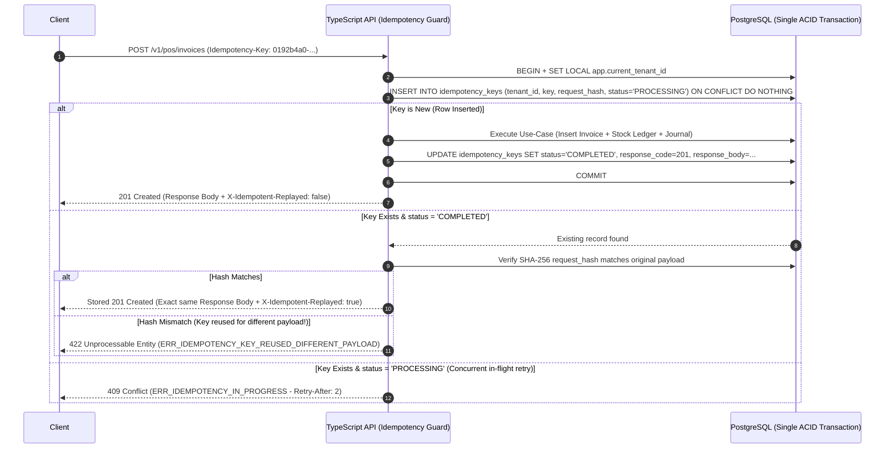

# 07 — API Design Strategy

| Metadata | Details |
| :--- | :--- |
| **Document ID** | `NEX-DOC-07` |
| **Status** | Approved Baseline (Rev 1.1 — UD-01..UD-05 Incorporated) |
| **Principle Addressed** | Principle #6 (DB Transactions), Principle #8 (Idempotent Transaction Processing) |

---

## 1. API Architectural Style & Contract-First Workflow

NexStock exposes a **RESTful HTTP/JSON API built with Fastify + TypeBox (`@sinclair/typebox` + `@fastify/type-provider-typebox` + `@fastify/swagger`)** (`UD-01`), emitting an **OpenAPI 3.1 specification** as the single source of truth across Web (Next.js), Desktop (Tauri + Vite React SPA), and Mobile (Flutter).

### Why Fastify + TypeBox + OpenAPI 3.1?
1. **Zero-Drift Runtime Validation & Spec Generation (`UD-01`)**: Route request/response schemas are authored in `packages/contracts` using TypeBox. Fastify compiles those exact TypeBox schemas via Ajv for high-speed runtime validation (`coerceTypes: false` on bodies) and automatically exports the OpenAPI 3.1 JSON specification.
2. **Cross-Language Support (TypeScript + Dart)**: Web (`apps/web`) and Tauri Desktop (`apps/desktop`) import `Static<typeof Schema>` types directly from `packages/contracts`, while Flutter (`apps/mobile`) generates strictly typed Dart models and API clients from the emitted OpenAPI 3.1 specification.
3. **Deterministic Idempotency & HTTP Caching**: POS sales, stock transfers, and offline command batches map cleanly to HTTP semantics, status codes, and standard headers.

---

## 2. Core API Headers & Request Context

Every API request supports the following standardized headers:

| Header | Required | Purpose |
| :--- | :--- | :--- |
| `Authorization` | Yes (except public health/webhook endpoints) | `Bearer <Supabase_Access_JWT>` |
| `X-Tenant-Id` | Yes (for tenant-scoped endpoints) | Target Tenant UUIDv7 (verified against caller's active memberships) |
| `Idempotency-Key` | **Required on all `POST` / `PATCH` financial & inventory mutations** | Client-generated UUIDv7 / ULID guaranteeing at-most-once execution |
| `X-Device-Id` | Required for POS & Warehouse clients | Registered device UUID |
| `Accept-Language` | Optional (`en-US` default) | Controls localized validation messages & receipt strings |
| `X-Request-Id` | Optional (generated by edge if omitted) | Distributed trace correlation ID echoed in responses and audit logs |

---

## 3. Idempotent Transaction Processing (`Idempotency-Key`)

Per **Principle #8**, network retries (especially on flaky store Wi-Fi or mobile cellular connections) must **never** result in duplicate POS invoices, double card/cash payment records, or double stock deductions.

### 3.1 Server-Side Idempotency State Machine



### 3.2 `idempotency_keys` Table Schema
- `(tenant_id, idempotency_key)` PRIMARY KEY
- `actor_user_id UUID NOT NULL`
- `endpoint TEXT NOT NULL`
- `request_hash CHAR(64) NOT NULL` (SHA-256 of canonicalized request body)
- `status TEXT NOT NULL` (`PROCESSING` | `COMPLETED`)
- `response_status_code INT`
- `response_body JSONB`
- `created_at TIMESTAMPTZ NOT NULL`
- `expires_at TIMESTAMPTZ NOT NULL` (TTL: 7 days for online API requests; 90 days for offline sync command keys in `sync_command_log`).

---

## 4. Data Serialization Standards (Money, Quantities, Dates)

To prevent precision loss across JSON serialization in JavaScript and Dart:

1. **Monetary Representation**:
   - Money values in JSON payloads are transmitted as **explicit stringified fixed-point decimals** (`"124.5000"`) alongside `currencyCode` (`"USD"`) and `amountMinor` (`12450` integer minor units where applicable):
   ```json
   {
     "currencyCode": "USD",
     "grandTotal": "124.5000",
     "grandTotalMinor": 12450
   }
   ```
2. **Quantities**:
   - Transmitted as stringified decimals (`"2.500000"`) or scaled micro-units (`2500000`) to avoid float rounding.
3. **Timestamps**:
   - Always ISO-8601 UTC strings (`"2026-10-26T01:24:00.000Z"`). Display formatting to local branch timezone occurs exclusively in the presentation layer using `branch.timezone`.

---

## 5. Standardized Pagination, Filtering & Sorting

### 5.1 Cursor-Based Pagination (Default for High-Volume Lists & Sync)
Offset pagination (`OFFSET 50000`) degrades linearly in PostgreSQL and skips/duplicates rows when new records are inserted concurrently.
- All list endpoints support **Keyset / Cursor Pagination** using UUIDv7 (`id`) or `sync_version`:
  `GET /v1/catalog/products?limit=50&cursor=0192b49f-8e1a-7000-8000-000000000001`
- Response envelope:
  ```json
  {
    "data": [ ... ],
    "pageInfo": {
      "hasNextPage": true,
      "nextCursor": "0192b4a0-1c2b-7000-8000-000000000050"
    }
  }
  ```

---

## 6. Standardized Error Contract (RFC 9457 Problem Details)

All API errors return `application/problem+json` with machine-readable error codes (`errorCode`) so Web, Tauri, and Flutter clients can localize error messages and trigger programmatic recovery flows:

```json
{
  "type": "https://api.nexstock.io/errors/insufficient-available-stock",
  "title": "Insufficient Available Stock",
  "status": 409,
  "detail": "Warehouse WH-MAIN has 3.000000 units available for SKU-1004, but 5.000000 were requested.",
  "instance": "/v1/inventory/transfers/0192b4a0-...",
  "errorCode": "INV_INSUFFICIENT_AVAILABLE_STOCK",
  "traceId": "req_0192b4a099f1",
  "extensions": {
    "warehouseId": "0192b400-...",
    "variantId": "0192b411-...",
    "availableQty": "3.000000",
    "requestedQty": "5.000000"
  }
}
```

---

## 7. Core Endpoint Surface by Module (`/v1/*`)

| ModulePrefix | Core Endpoints | Idempotent? |
| :--- | :--- | :--- |
| `/v1/auth` | `GET /me`, `POST /supervisor-override`, `POST /devices/enroll` | Yes |
| `/v1/tenants` | `GET /current`, `PATCH /current`, `GET /branches`, `POST /branches`, `GET /warehouses`, `POST /warehouses`, `POST /registers` | Yes |
| `/v1/iam` | `GET /members`, `POST /members/invite`, `PATCH /members/:id/roles`, `PUT /members/:id/scopes`, `GET /roles`, `POST /roles` | Yes |
| `/v1/subscriptions` | `GET /current`, `POST /admin/provision` (plans/trials/status), `GET /invoices`, `POST /invoices/:id/payments` (manual/recorded payment), `POST /webhooks/:provider` (optional future provider adapter) | **Strict (Required on payments/provision)** |
| `/v1/catalog` | `GET /products`, `POST /products`, `PATCH /products/:id`, `POST /variants/:id/barcodes`, `GET /price-lists`, `PUT /price-lists/:id/items` | Yes |
| `/v1/inventory` | `GET /balances`, `GET /ledger`, `POST /transfers`, `POST /transfers/:id/dispatch`, `POST /transfers/:id/receive`, `POST /stocktakes`, `POST /stocktakes/:id/counts`, `POST /stocktakes/:id/approve`, `POST /adjustments` | **Strict (Required)** |
| `/v1/pos` | `POST /shifts/open`, `POST /shifts/:id/cash-movement`, `POST /shifts/:id/close`, `POST /invoices`, `POST /invoices/:id/void`, `POST /returns` | **Strict (Required)** |
| `/v1/purchasing` | `GET /suppliers`, `POST /suppliers`, `POST /purchase-orders`, `POST /purchase-orders/:id/approve`, `POST /goods-receipts`, `POST /supplier-bills` | **Strict (Required)** |
| `/v1/finance` | `GET /reports/z-report`, `GET /reports/sales-summary`, `GET /reports/inventory-valuation`, `GET /reports/tax-liability`, `GET /journals`, `POST /periods/:id/lock` | Yes |
| `/v1/sync` | `GET /pull` (delta changes by watermark), `POST /push` (ordered offline command batch), `GET /conflicts`, `POST /conflicts/:id/resolve` | **Strict (Per-Command Key)** |
