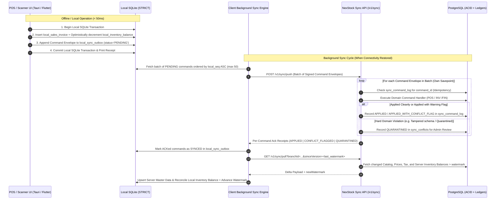

# 08 — Offline Synchronization Design

| Metadata | Details |
| :--- | :--- |
| **Document ID** | `NEX-DOC-08` |
| **Status** | Approved Baseline (Rev 1.1 — UD-01..UD-05 Incorporated) |
| **Principle Addressed** | Principle #7 (Auditable Stock History), Principle #8 (Idempotency), Principle #9 (Offline Sync & Conflict Resolution) |

---

## 1. Offline-First Design Philosophy

Generic table-replication or document CRDT frameworks fail in enterprise POS and Inventory systems because:
1. **Inventory and Financial Ledgers are Command-Driven, Not State-Overwritten**: Two POS terminals selling the same SKU while offline must **never** overwrite `inventory_balances.qty_on_hand` with their local snapshot ("Last-Write-Wins" on a balance column would silently erase sales!). Instead, each terminal must emit an immutable **Domain Command** (`RecordPosSaleCommand` with delta `-1`), which the server applies sequentially to the append-only `stock_ledger_entries`.
2. **Physical Reality Precedence**: If a customer physically walks out of a brick-and-mortar store with an item and a printed receipt while the internet is down, that sale **already happened in the physical world**. The server cannot reject the sale 4 hours later during sync just because online stock reached zero; it must accept the sale, record the stock deduction (allowing temporary negative stock if necessary), and flag an inventory discrepancy alert for the branch manager.

Therefore, NexStock uses an **Asymmetric Hybrid Sync Architecture**:
- **Downstream (Server → Client Pull)**: **Watermark-Based Delta State Sync** of read-models (Catalog, Barcodes, Prices, Tax Rules, Branch Staff, Customers, and Latest Server Inventory Balances).
- **Upstream (Client → Server Push)**: **Ordered Idempotent Command Log (Outbox Replay)** of business transactions (Shift Open/Close, POS Invoices, Returns, Stocktake Counts, Transfer Receipts).

### 1.1 Approved Platform Offline Scope (`UD-04`)

| Client Platform | Offline Mode | Local Storage | Supported Offline Operations |
| :--- | :--- | :--- | :--- |
| **Browser Web App (`apps/web`)** | **Online-First** | In-memory / React Query cache only (Browser OPFS/WASM SQLite deferred) | Back-office administration, financial reporting, purchasing, and cloud-connected POS. Displays immediate offline banner if internet drops. |
| **Tauri Desktop (`apps/desktop`)** | **Full Offline-First** | Native SQLite (`STRICT` + `WAL` mode, SQLCipher encrypted) | Shift open/close, cash movements, barcode scan, cart pricing/tax, split payments, receipt printing, returns, stock counts, and transfer receipts. |
| **Flutter Mobile (`apps/mobile`)** | **Full Offline-First** | Native SQLite via `drift` (`STRICT` + `WAL` mode, SQLCipher encrypted) | Mobile POS checkout, barcode scanning, blind/guided stocktake counts, GRN receiving, and inter-warehouse transfer receipts. |

---

## 2. End-to-End Synchronization Topology



---

## 3. Local SQLite Storage Architecture (Tauri & Flutter)

Both Tauri (Desktop) and Flutter (Mobile) execute the canonical SQLite migrations from `packages/sqlite-schema`. All SQLite tables use `STRICT` mode and `PRAGMA journal_mode = WAL;` (Write-Ahead Logging) for crash resilience and concurrent UI reads during background sync writes.

### 3.1 Core Local SQLite Table Categories

1. **Synced Master Read-Tables (Server-Authoritative)**:
   - `local_products`, `local_product_variants`, `local_product_barcodes`
   - `local_price_list_items`, `local_tax_groups`, `local_tax_rates`, `local_exchange_rates`
   - `local_customers`, `local_branch_staff_auth`
2. **Optimistic Balance Projection Table**:
   - `local_inventory_balances`: Stores `server_qty_on_hand` (from last pull watermark) and `local_pending_qty_delta` (sum of unsynced local outbox stock changes).
   - Effective local available stock displayed to the cashier:
     $$\text{LocalAvailable} = \text{server\_qty\_on\_hand} + \text{local\_pending\_qty\_delta} - \text{server\_qty\_reserved}$$
3. **Local Transactional & Outbox Tables (Client-Authoritative until Synced)**:
   - `local_pos_shifts`, `local_sales_invoices`, `local_sales_invoice_lines`, `local_sales_payments`
   - `local_sync_outbox`:
     ```sql
     CREATE TABLE local_sync_outbox (
       local_seq INTEGER PRIMARY KEY AUTOINCREMENT,
       command_id TEXT NOT NULL UNIQUE,          -- UUIDv7 (Idempotency Key)
       tenant_id TEXT NOT NULL,
       branch_id TEXT NOT NULL,
       device_id TEXT NOT NULL,
       actor_user_id TEXT NOT NULL,
       command_type TEXT NOT NULL,               -- e.g. 'POS_RECORD_SALE', 'POS_OPEN_SHIFT'
       schema_version INTEGER NOT NULL,
       payload_json TEXT NOT NULL,               -- Canonical JSON command payload
       occurred_at TEXT NOT NULL,                -- ISO-8601 UTC timestamp when executed offline
       status TEXT NOT NULL DEFAULT 'PENDING',   -- PENDING | IN_FLIGHT | SYNCED | QUARANTINED
       retry_count INTEGER NOT NULL DEFAULT 0,
       last_error TEXT,
       server_ack_at TEXT
     ) STRICT;
     ```
   - `local_sync_watermarks`: Tracks `last_pulled_sync_version` per entity stream (`catalog`, `pricing`, `inventory`, `customers`).

---

## 4. Offline Invoice & Document Numbering Strategy

To prevent duplicate human-readable invoice numbers when multiple registers operate offline simultaneously:
- Each registered POS terminal is assigned a unique `register_code` within its branch (e.g., `BR01-R02`).
- Offline-capable document numbers are deterministically scoped to the register:
  `{BRANCH_CODE}-{REGISTER_CODE}-{YYYYMMDD}-{LOCAL_MONOTONIC_SEQ}` (e.g., `NYC01-REG02-20261026-000145`).
- Because each physical device owns a single `register_id`, two registers can never generate colliding invoice numbers even during a 72-hour internet blackout.

---

## 5. Domain-Specific Conflict Resolution Matrix

Rather than a naive one-size-fits-all conflict strategy, NexStock defines explicit, deterministic conflict resolution rules per business scenario:

| Conflict Scenario | What Happened Offline? | Resolution Policy | System Behavior & Audit Trail |
| :--- | :--- | :--- | :--- |
| **1. Concurrent Offline POS Sale Depletes Stock Below Zero** | Register 1 (offline) and Register 2 (online) both sell the last 1 unit of `SKU-A`. | **Accept Sale + Allow Negative Balance + Flag Variance (`ALWAYS_ACCEPT_PHYSICAL_SALE`)** | Server commits Register 1's invoice, posts `-1` to `stock_ledger_entries` (resulting in `qty_on_hand = -1`), sets `sales_invoices.has_sync_stock_conflict = true`, and creates a `NEGATIVE_STOCK_VARIANCE` task in `sync_conflicts` for the Branch Manager to verify physical stock. |
| **2. Catalog Price or Tax Rate Changed on Server While POS Was Offline** | HQ changes `SKU-A` price from `$10.00` to `$12.00` at 10:00 AM. Offline Register sells `SKU-A` at 10:15 AM for `$10.00` using its cached price list. | **Honor Point-of-Sale Contract Snapshot (`HONOR_CAPTURED_INVOICE_PRICE`)** | The customer already paid `$10.00` and left. The command payload carries `unit_price`, `tax_rate_snapshot`, and `price_list_sync_version`. Server accepts the exact `$10.00` invoice total so cash/card tender balances match, and logs a `PRICE_STALE_AT_OFFLINE_SALE` informational audit note. |
| **3. Product Deactivated or Deleted in HQ While Sold Offline** | HQ marks `SKU-B` as `is_active = false` (soft delete). Offline register sells `SKU-B`. | **Honor Reference via Soft-Delete Preservation** | Because master records are never hard-deleted once referenced (only `is_active = false` / `deleted_at` set), the foreign key `variant_id` remains valid. Server commits the sale and logs an audit note. |
| **4. Duplicate Serial Number Sold on Two Offline Registers** | Two offline cashiers accidentally scan/type the same unique `serial_number` (`SN-99881`) on two separate invoices. | **Accept Financial Sale + Quarantine Serial Binding (`SERIAL_COLLISION_RESOLUTION`)** | Second invoice's financial & aggregate SKU quantity deduction is committed so the register shift reconciles, but the specific `serial_id` binding is flagged in `sync_conflicts` (`DUPLICATE_SERIAL_SALE`) for warehouse supervisor resolution. |
| **5. Offline Stocktake Count vs. Concurrent Sales/Movements** | Clerk counts 50 units of `SKU-C` at `14:00` offline (`counted_at = 14:00`). Before sync at `16:00`, 3 units are sold (`14:30`). | **Timestamp-Anchored Delta Comparison (`BOOK_AT_COUNT_TIMESTAMP`)** | Server does **not** overwrite current stock to 50! Instead, server reconstructs book balance as of `counted_at (14:00)` from `stock_ledger_entries` (e.g., 52 units at 14:00), computes the true variance (`50 - 52 = -2` units lost), and posts a `-2` adjustment delta, leaving current stock accurately at `50 - 3 = 47`. |
| **6. Offline Store Credit / Gift Card Double-Spend** | Customer spends the same `$50` store credit balance at two offline branches before sync. | **Accept Tender + Negative Credit Balance Flag (`ALLOW_CREDIT_OVERDRAFT_FLAG`)** | Both invoices are committed; customer's `store_credit_accounts` balance goes negative (`-$50`) and triggers a high-priority fraud/collections alert in `sync_conflicts`. |
| **7. Master Data Edit Conflict (e.g., Customer Profile Edited on Two Devices)** | Phone number updated offline on Device A and online on Web. | **Field-Level Timestamp / Server-Authoritative Merge (`LWW_WITH_AUDIT`)** | Master data edits compare per-record `updated_at` / `sync_version` and log the superseded field values in `audit_logs`. |

---

## 6. Duplicate Prevention, Transaction Replay & Crash Recovery (`UD-04`)

### 6.1 Multi-Layer Duplicate Prevention
Offline networks frequently suffer from "half-open" TCP drops where the server commits a `POST /v1/sync/push` batch, but the HTTP response is lost before reaching the device.
1. **Deterministic Client `command_id` (UUIDv7)**: Generated inside the local SQLite transaction when the cashier taps "Complete Sale" and persisted in `local_sync_outbox.command_id`. It is never regenerated on retry.
2. **Server `sync_command_log` Deduplication**: Before executing any command handler, the server checks `SELECT status, result_json FROM sync_command_log WHERE tenant_id = $1 AND command_id = $2`. If already `APPLIED`, the server immediately returns the stored acknowledgement without re-executing the sale or stock movement.
3. **Domain Entity Uniqueness Constraints**: Even if two different `command_id` envelopes attempted to insert the same invoice, PostgreSQL enforces `UNIQUE (tenant_id, id)` and `UNIQUE (tenant_id, client_idempotency_key)` on `sales_invoices` and `stock_ledger_entries`.

### 6.2 Deterministic Transaction Replay & Causal Ordering
1. **Causal Ordering Per Shift/Register**: Commands inside `local_sync_outbox` are pushed in strict `local_seq ASC` order so `POS_OPEN_SHIFT` is always replayed before `POS_RECORD_SALE`, which is replayed before `POS_RECORD_RETURN` and `POS_CLOSE_SHIFT`.
2. **Savepoint Isolation**: In `POST /v1/sync/push`, each command in a batch executes inside its own PostgreSQL `SAVEPOINT`. If command #4 fails due to a transient lock timeout or quarantine rule, commands #1–#3 remain committed and acknowledged.
3. **Optimistic Balance Convergence**: When a command transitions from `PENDING` to `SYNCED` on the client, its contribution to `local_pending_qty_delta` is cleared atomically alongside the subsequent `/v1/sync/pull` watermark update so local stock never double-counts or flickers.

### 6.3 Poison-Pill Quarantine & Device Recovery Workflows
1. **Poison-Pill Quarantine**: If a single malformed command fails with a permanent domain/validation error (`4xx`), the server records the full command envelope and error diagnostics in `sync_conflicts` (`status = 'QUARANTINED'`) and returns a `QUARANTINED` receipt. The client marks that command `QUARANTINED` locally and **continues syncing subsequent commands** rather than blocking the register's entire outbox queue.
2. **Admin Quarantine Resolution**: Tenant/Branch Admins inspect quarantined commands in the Web Backoffice (`/sync/conflicts`) and can either:
   - **Amend & Replay**: Fix a missing reference (e.g., map an unreferenced batch or resolve a serial collision) and replay the command on the server within a tracked audit transaction.
   - **Dismiss with Compensating Entry**: Mark the conflict resolved with a mandatory audit reason.
3. **Local Crash Recovery (`WAL` + Stuck `IN_FLIGHT` Reset)**:
   - SQLite runs with `PRAGMA journal_mode = WAL;` and `PRAGMA synchronous = NORMAL;` (or `FULL` on desktop power-loss sensitive terminals).
   - On application startup (Tauri or Flutter), the Sync Engine resets any `local_sync_outbox` rows stuck in `status = 'IN_FLIGHT'` back to `status = 'PENDING'` and resumes pushing with exponential backoff + jitter (`1s`, `2s`, `4s`, `8s` ... max `60s`).
4. **Encrypted Outbox Emergency Export**: If a physical tablet/PC suffers OS corruption or hardware screen damage while holding unsynced sales, an administrator can export the signed `local_sync_outbox` JSON bundle via USB/recovery CLI and upload it to `POST /v1/sync/admin-import` for idempotent server replay.
