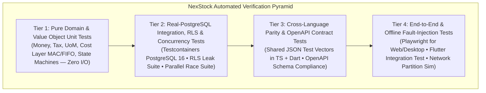

# 09 — Testing and Quality Assurance Strategy

| Metadata | Details |
| :--- | :--- |
| **Document ID** | `NEX-DOC-09` |
| **Status** | Approved Baseline (Rev 1.1 — UD-01..UD-05 Incorporated) |
| **Principle Addressed** | Principle #5 (Tenant Isolation), Principle #6 (Transactions), Principle #8 (Idempotency), Principle #10 (Automated Testing & Incremental Releases) |
| **Status Note** | **Phase 1 (`M0` + `M1`) Verified Locally**: TypeScript unit tests (`packages/domain-core`) and PostgreSQL 16 integration/RLS/concurrency/migration tests (`apps/api` via `@electric-sql/pglite`) are implemented and passing. Dart/Flutter cross-language parity tests (`apps/mobile`) and live remote Supabase `PRODUCTION` execution remain pending their respective milestones/operator runs. |

---

## 1. Quality Philosophy & Testing Pyramid

In a multi-tenant Inventory and POS platform, a bug in tax rounding, stock ledger calculation, or tenant isolation has direct financial and legal consequences. Our QA strategy prioritizes **deterministic domain verification and real-database integration testing** over brittle mock-heavy unit tests.



---

## 2. Specialized Verification Suites

### 2.1 Cross-Language Calculation Parity Suite (TypeScript ↔ Dart)
Because offline POS terminals run on both **Tauri (TypeScript)** and **Flutter (Dart)**, an invoice calculated offline on an Android tablet must produce the **exact same** subtotal, line discount, compound tax breakdown, and currency minor-unit rounding to the fourth decimal place as an invoice calculated on a Windows Tauri register or the TypeScript Backend API.

- **Mechanism**: `packages/domain-core/test-vectors/` contains canonical JSON fixture files:
  - `tax-inclusive-exclusive-vectors.json` (200+ edge cases including 0-decimal JPY, 2-decimal USD/EUR, 3-decimal KWD, compound taxes, split discounts)
  - `uom-conversion-vectors.json`
  - `inventory-valuation-mac-fifo-vectors.json`
- **CI Enforcement**: Both `pnpm --filter @nexstock/domain-core test` (Vitest) and `flutter test test/domain_parity_test.dart` ingest these exact JSON files and assert 100% bit-for-bit output equivalence.

### 2.2 Automated Multi-Tenant RLS Penetration & Isolation Suite
Every tenant-scoped table and API endpoint must pass an automated **Cross-Tenant Leak Test** running against a real PostgreSQL container (`Testcontainers`):
1. Seed `Tenant_Alpha` and `Tenant_Beta` with identical SKU codes, barcodes, branches, warehouses, and POS invoices.
2. Execute every repository query and HTTP endpoint authenticated as `User_Alpha` (`Tenant_Alpha`) while passing `Tenant_Beta`'s entity UUIDs in path parameters, query filters, and request bodies.
3. **Pass Criteria**:
   - Reads must return `404 Not Found` or empty sets (never `Tenant_Beta` data).
   - Writes/Updates/Deletes targeting `Tenant_Beta` UUIDs must fail with `404` or `403` and leave `Tenant_Beta` rows completely untouched.
   - Direct SQL queries executed inside `withTenantContext(Tenant_Alpha)` without a `WHERE tenant_id = ...` clause must return zero rows belonging to `Tenant_Beta` (proving `FORCE ROW LEVEL SECURITY` and `NOBYPASSRLS` are active).

### 2.3 Concurrency, Locking & Ledger Invariant Suite
Inventory and financial operations are tested under concurrent race conditions using `Promise.all` parallel workers against PostgreSQL:
1. **Parallel Stock Deduction Race**:
   - Seed `10` units of `SKU-001` in `WH-MAIN` (`allow_negative_stock = false` for online orders).
   - Fire `25` simultaneous `POST /v1/pos/invoices` requests (each buying `1` unit) across 25 parallel connections.
   - **Assertions**:
     - Exactly `10` requests succeed (`201 Created`) and `15` fail with `409 Conflict (INV_INSUFFICIENT_AVAILABLE_STOCK)`.
     - `inventory_balances.qty_on_hand` equals `0.000000`.
     - `SELECT SUM(qty_delta) FROM stock_ledger_entries WHERE variant_id = ...` equals `inventory_balances.qty_on_hand` (`0.000000`).
2. **Idempotency Storm Test**:
   - Fire `20` concurrent `POST /v1/pos/invoices` requests carrying the **identical** `Idempotency-Key` and payload.
   - **Assertions**:
     - Only **1** invoice row, **1** stock ledger deduction, and **1** financial journal entry are created in PostgreSQL.
3. **Double-Entry Balance Check**:
   - After every integration test suite run, a global teardown assertion verifies:
     ```sql
     SELECT journal_entry_id
     FROM journal_entry_lines
     GROUP BY journal_entry_id
     HAVING SUM(debit_amount) <> SUM(credit_amount);
     ```
     Must return **0 rows**.

### 2.4 Offline Synchronization & Conflict Simulation Suite
Using an in-memory/temp-file SQLite database paired with the real backend API:
1. **Network Partition Simulation**:
   - Sync catalog to 2 simulated POS devices (`Device_1`, `Device_2`).
   - Disconnect both devices from the API.
   - Process 50 sales, 3 returns, 2 cash-drops, and 1 blind stocktake across both devices with overlapping SKUs.
   - Reconnect both devices and trigger `/v1/sync/push` + `/v1/sync/pull` with simulated network drops (aborting mid-batch) and retries.
   - **Assertions**:
     - All 50 sales and 3 returns are recorded exactly once on the server.
     - Both devices converge to the exact same `qty_on_hand` after completing their pull cycle.
     - Any stock driven below zero offline produces a corresponding record in `sync_conflicts`.

### 2.5 Inventory Valuation & Non-Retroactive Accounting Suite (`UD-03`)
Dedicated integration tests verify the mathematical and accounting invariants defined in `NEX-DOC-04` Section 4:
1. **MAC & Negative-Stock Recovery Test**:
   - Offline sale drives `qty_on_hand` to `-5` at historical MAC of `$10.00`. Subsequent GRN receives `+15` units at `$12.00`.
   - Assert that historical `sales_invoice_lines` and `stock_ledger_entries` remain untouched, `$10.00` variance (`5 * ($12 - $10)`) is posted to `Purchase Price Variance / COGS Adj` in the current period, and remaining `10` units are valued at `MAC = $12.0000` (`total_inventory_value = $120.0000`).
2. **FIFO Multi-Layer Consumption & Return Test**:
   - Receive Batch A (`5 @ $8.00`) and Batch B (`5 @ $10.00`). Sell `7` units across both layers (`COGS = 5*8 + 2*10 = $60.00`). Process referenced customer return (`RESTOCK_SELLABLE` vs. `WRITE_OFF_DAMAGED`) and verify exact cost restoration and journal balance.
3. **Post-Sale Landed Cost / Supplier Bill Variance Test**:
   - Receive `100` units `@ $10.00`, sell `40` units, then apply a `+$200.00` Landed Cost Voucher.
   - Assert `+$120.00` (`60%`) is capitalized via a `COST_REVALUATION` ledger entry onto the remaining `60` units, `+$80.00` (`40%`) is expensed to `Purchase Price Variance`, and zero previously posted sale rows are mutated.

---

## 3. CI/CD Quality Gates & Incremental Release Strategy

Every Pull Request must pass the following automated pipeline gates before merge:

| Stage | Check | Blocking? |
| :--- | :--- | :--- |
| **1. Static Analysis & Architecture Lint** | TypeScript `tsc --noEmit`, `eslint` (including `eslint-plugin-boundaries` DAG check), `dart analyze` | **Yes** |
| **2. Schema & Contract Drift Check** | Verify OpenAPI spec matches generated TS/Dart clients; verify SQLite schema parity | **Yes** |
| **3. Unit & Cross-Language Parity Tests** | Vitest (`packages/domain-core`, `apps/api`) + `flutter test` against shared JSON test vectors | **Yes** |
| **4. Database Integration & RLS Tests** | Ephemeral PostgreSQL 16 service container running all module integration, RLS leak, and concurrency tests | **Yes** |
| **5. Migration Roll-Forward / Compatibility Check** | Apply all SQL migrations to clean DB + verify zero-downtime backward compatibility rules | **Yes** |

### Zero-Downtime Database Evolution Rules
Once in production, database migrations must follow the **Expand-and-Contract** pattern:
- Never rename or drop a column in a single release while old API instances or older offline clients are still active.
- Add nullable columns or new tables first (**Expand**), dual-write/backfill, and remove deprecated columns only after all active clients have upgraded past the minimum supported schema version (**Contract**).
