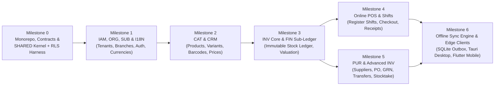

# 10 — Development Roadmap, Dependencies, Risks & Milestone 0 Plan

| Metadata | Details |
| :--- | :--- |
| **Document ID** | `NEX-DOC-10` |
| **Status** | Approved Baseline (Rev 1.1 — UD-01..UD-05 Incorporated) |
| **Principle Addressed** | Principle #10 (Incremental Releases), Principle #11 (Avoid Premature Microservices), Principle #12 (No Initial AI Features) |

---

## 1. Phased Implementation Roadmap & Dependency Graph

Because modules have strict data and domain dependencies (e.g., `POS` cannot sell items before `CAT` defines products, `INV` tracks balances, and `ORG` defines branches/registers), implementation proceeds across **7 sequential milestones**. Each milestone produces a deployable, testable increment.



---

## 2. Detailed Milestone Breakdown

### Milestone 0: Foundation, Monorepo & Database Security Harness (`SHARED`)
- **Deliverables**:
  - Workspace monorepo setup (`apps/api`, `apps/web`, `apps/desktop`, `apps/mobile`, `packages/contracts`, `packages/domain-core`, `packages/ui`, `packages/sqlite-schema`, `packages/config`).
  - `SHARED` kernel: `Money` and `Quantity` fixed-point value objects, `ValuationCalculator` (MAC + FIFO), UUIDv7 generator, RFC 9457 error framework.
  - Fastify + TypeBox + Kysely server harness with `nexstock_app_user` (`NOBYPASSRLS`), `withTenantTransaction` (`SET LOCAL`) wrapper, `idempotency_keys` guard, `outbox_events` worker, and `audit_logs` writer.
  - Automated Testcontainers PostgreSQL + RLS isolation test harness.
  - Canonical JSON test vector runner for TypeScript and Dart.
- **Dependencies**: None.

### Milestone 1: Platform Governance — Identity, Tenants, Locations & Subscriptions (`IAM`, `ORG`, `SUB`, `I18N`)
- **Deliverables**:
  - Supabase Auth JWT verification middleware and user profile synchronization.
  - Tenant onboarding, base currency configuration, exchange rate tables, and tax group/rate definitions (`I18N`).
  - Branch, Warehouse, Bin, and POS Register creation (`ORG`).
  - RBAC roles, permission matrix, location scope enforcement, and Argon2id POS PIN setup (`IAM`).
  - Admin-provisioned subscription plans, trials, subscription lifecycle status, invoice/payment records, and quota enforcement guards behind `SubscriptionBillingPort` (`SUB`).
  - Next.js Web Admin views for Organization Settings, Branches/Warehouses, Staff & Roles, Subscriptions, and Tax/Currency setup.
- **Dependencies**: Milestone 0.

### Milestone 2: Catalog, Pricing & Customer Core (`CAT`, `CRM`)
- **Deliverables**:
  - Categories, Brands, Units of Measure (UoM) & conversion rules.
  - Products (Standard, Variant Matrix, Bundles, Services) and multi-barcode registry (`EAN-13`, `UPC-A`, `Code128`).
  - Price lists, branch-specific price overrides, and tax-inclusive/exclusive calculation engine.
  - Customer directory and store credit accounts (`CRM`).
  - Next.js Web Catalog & Price List management UI.
- **Dependencies**: Milestone 1.

### Milestone 3: Immutable Stock Ledger & Financial Sub-Ledger Core (`INV`, `FIN`)
- **Deliverables**:
  - `stock_ledger_entries` (append-only enforced via DB trigger) and `inventory_balances` with row-level lock helpers.
  - Moving Average Cost (MAC) engine for standard/serialized inventory and FIFO cost layer engine (`inventory_cost_layers`) for batch/lot-tracked inventory; serial number registry.
  - Double-entry `journal_entries` and `journal_entry_lines` sub-ledger in `FIN` (including `Purchase Price Variance / COGS Adjustment` and `GRNI` clearing accounts).
  - Manual Stock Adjustments (gain/loss/damage write-off) with approval thresholds.
  - Next.js Web Inventory Balances & Stock Card Ledger Audit UI.
- **Dependencies**: Milestone 2.

### Milestone 4: Point of Sale (POS), Shifts & Billing (`POS` + `FIN` Reports)
- **Deliverables**:
  - Register Shift lifecycle (`OPEN` → cash movements → blind/counted `CLOSE` with cash variance posting).
  - High-speed POS checkout API & Web Cloud POS UI: barcode scan, split tenders, multi-currency payment acceptance, discounts, supervisor PIN override, hold/park orders, returns & exchanges (`RESTOCK_SELLABLE` vs. `WRITE_OFF_DAMAGED`).
  - Thermal receipt generator (80mm/58mm layout + PDF).
  - Branch Z-Reports, X-Reports, Sales Summary, and Tax Liability reports (`FIN`).
- **Dependencies**: Milestone 3.

### Milestone 5: Purchasing, Suppliers & Multi-Warehouse Operations (`PUR` + `INV` Advanced)
- **Deliverables**:
  - Supplier management and supplier SKU catalog.
  - Purchase Order (`PO`) workflow, Goods Receipt Notes (`GRN`) with batch/serial capture, Supplier Bills, and non-retroactive Landed Cost / Purchase Price Variance allocation.
  - Inter-warehouse Stock Transfers (`DRAFT` → `IN_TRANSIT` → `RECEIVED`) and Stocktake / Cycle Count sessions with timestamp-anchored variance reconciliation.
- **Dependencies**: Milestone 3.

### Milestone 6: Offline Sync Engine, Tauri Desktop POS & Flutter Mobile App (`SYNC`)
- **Deliverables**:
  - `/v1/sync/pull` (watermark delta feed) and `/v1/sync/push` (idempotent command batch processor + `sync_conflicts` resolution dashboard).
  - Canonical SQLite `STRICT` schema package (`packages/sqlite-schema`) and local Outbox Sync Worker.
  - **Tauri Desktop Application (`apps/desktop`)**: Vite + React + TS SPA shell sharing `packages/ui`, local SQLite persistence, offline POS checkout, native USB/Network ESC/POS printer & barcode scanner integration.
  - **Flutter Mobile Application (`apps/mobile`)**: Local SQLite (`drift`) persistence, mobile barcode scanning, offline cycle counting/stocktake, GRN receiving, and mobile POS.
- **Dependencies**: Milestones 4 & 5.

---

## 3. Major Technical Risks & Mitigations

| Risk ID | Risk Description | Severity | Likelihood | Mitigation Strategy |
| :--- | :--- | :---: | :---: | :--- |
| **RISK-01** | **Cross-Language Calculation Drift (TypeScript vs. Dart)**: Subtle rounding differences in tax or discount math between Web/Desktop (TS) and Mobile (Flutter/Dart) cause server validation mismatches when syncing offline invoices. | **High** | **Medium** | Enforce fixed-point integer arithmetic in both languages and gate CI on a shared suite of 200+ canonical JSON test vectors (`packages/domain-core/test-vectors/`). Server also honors captured offline invoice price snapshots within configured tolerance while logging audit flags. |
| **RISK-02** | **PostgreSQL RLS Connection Pool Bleeding**: Session variables set on a pooled connection leak to a subsequent request from another tenant. | **Critical** | **Low (with design)** | Never use session-level `SET`. Enforce `set_config(..., true)` (`SET LOCAL`) inside Kysely's `withTenantTransaction` (`BEGIN ... COMMIT`), combined with `NOBYPASSRLS` database role and composite foreign keys. |
| **RISK-03** | **Hot-SKU Row Lock Contention**: High-throughput flash sales of the same SKU in the same warehouse serialize on `SELECT ... FOR UPDATE` on `inventory_balances`. | **Medium** | **Medium** | Keep transactions extremely short (no external HTTP/network calls inside `withTenantTransaction`), sort locked `(warehouse_id, variant_id)` pairs in deterministic UUID order to prevent deadlocks, and process async notifications via `outbox_events`. |
| **RISK-04** | **Next.js SSR vs. Tauri Desktop Static Bundle Incompatibility**: Using Next.js Server Components/Server Actions prevents compiling the React UI into a static bundle required by Tauri's local WebView. | **High** | **Resolved (`UD-02`)** | Resolved by using a dedicated **Vite + React + TypeScript SPA** inside Tauri (`apps/desktop`) and **Next.js** for browser (`apps/web`), sharing UI components via `packages/ui`. |
| **RISK-05** | **Poison-Pill Command Blocking Offline Terminal Outbox**: A single invalid offline command blocks all subsequent commands in the terminal's FIFO queue. | **High** | **Medium** | Server processes each command in a push batch inside its own PostgreSQL `SAVEPOINT` and transitions permanently invalid commands to `QUARANTINED` status in `sync_conflicts`, allowing subsequent queue items to sync normally. |
| **RISK-06** | **Local SQLite Data Exposure on Stolen POS Tablet/Laptop**: Unencrypted local SQLite file exposes tenant catalog, customer list, and offline transactions. | **High** | **Medium** | Use SQLCipher encryption for local SQLite databases on Tauri and Flutter, storing the encryption key in the OS Keychain / Keystore, and enforce 14-day offline token expiry. |
| **RISK-07** | **Post-Sale Purchase Price Variance / Negative Inventory Cost Drift (`UD-03`)**: A supplier bill or landed cost voucher arrives *after* received stock has already been partially or fully sold, or a receipt replenishes negative stock caused by offline POS sales. | **High** | **High** | Strictly forbid retroactive edits to historical `stock_ledger_entries` or `sales_invoice_lines`. Capitalize cost adjustments only on `remaining_qty` still on hand (`COST_REVALUATION`) and expense the already-sold/deficit share directly to `5150 Purchase Price Variance / COGS Adjustment` in the current open accounting period. |
| **RISK-08** | **Sri Lankan SaaS Payment Gateway & Cross-Border Payout Constraints (`UD-05`)**: Global gateways like Stripe do not natively onboard Sri Lankan domestic entities directly without foreign incorporation, while local gateways (e.g., PayHere, DirectPay, local bank IPGs) have specific CBSL FX, recurring token, and LKR/USD settlement rules. | **Medium** | **High** | Decouple initial release from mandatory payment gateways by launching with `ManualAdminBillingAdapter` (admin-provisioned trials, plans, invoices, and recorded payments) behind `SubscriptionBillingPort`. Evaluate merchant eligibility, CBSL rules, LKR/USD settlement, payout timing, and fees before implementing a live provider adapter. |

---

## 4. Approved Architectural Decisions (`UD-01` – `UD-05`) & Recorded Assumptions

All five architectural decision gates have been formally reviewed and locked:

| Decision ID | Status | Approved Specification |
| :--- | :---: | :--- |
| **`UD-01`** | **APPROVED** | **Fastify + TypeBox + Kysely** backend. TypeBox defines request/response validation and OpenAPI 3.1 schemas (`coerceTypes: false` on bodies); Kysely manages explicit SQL queries, `FOR UPDATE` row locks, and `withTenantTransaction` (`SET LOCAL app.current_tenant_id`) for PostgreSQL RLS. |
| **`UD-02`** | **APPROVED** | **Vite + React + TypeScript SPA inside Tauri** (`apps/desktop`) and **Next.js** (`apps/web`) sharing reusable UI components via `packages/ui`. All business logic and authorization remain exclusively in `apps/api`. |
| **`UD-03`** | **APPROVED** | **Moving Average Cost (MAC)** for standard/serialized inventory (`NONE`, `SERIAL`) and **FIFO Cost Layers** for batch/lot inventory (`BATCH_EXPIRY`). Historical posted transactions are immutable; variances from post-sale landed costs or negative-stock replenishment post to `Purchase Price Variance / COGS Adjustment` in the current open period. |
| **`UD-04`** | **APPROVED** | **Online-first Browser (`apps/web`)** for back-office, reporting, and cloud POS (deferring browser OPFS/WASM SQLite). **Full offline-first SQLite** workflows in **Tauri Desktop (`apps/desktop`)** and **Flutter Mobile (`apps/mobile`)** with deterministic command outbox replay and conflict recovery. |
| **`UD-05`** | **APPROVED** | **Admin-provisioned plans, trials, subscription status, and invoice/payment records** for the initial release behind a provider-neutral `SubscriptionBillingPort`. External payment gateway selection is deferred pending Sri Lankan merchant eligibility, payout, fee, and compliance verification. |

### Recorded Architectural Assumptions
1. **Composite Assembly Items (`product_type = 'BUNDLE'`)**: In Phase 1, bundles are **Kit-at-Sale (Phantom Assemblies)**—selling 1 Bundle deducts its constituent `bundle_components` directly from `inventory_balances` at each component's respective MAC/FIFO cost, rather than requiring a separate work-order manufacturing module.
2. **Inter-Warehouse Transfer Valuation**: Stock transfers between warehouses within the same tenant (`TRANSFER_OUT` → `TRANSFER_IN`) move inventory at **cost** (zero internal profit markup), preserving the exact valuation from the source warehouse via `1310 Inventory In-Transit Asset`.
3. **Closed Accounting Period Protection**: If an offline device syncs a transaction whose `occurred_at` date falls into a recently locked accounting period (`accounting_periods.status = 'LOCKED'`), the transaction is recorded with `occurred_at` preserved for operational audit, while its financial `journal_entries.posting_date` is set to the first day of the earliest `OPEN` accounting period.

---

## 5. Milestone 0 Implementation Plan (Pending Final Sign-Off to Execute)

Per project constraints, no application code or database migrations have been created yet. Upon your approval of this Milestone 0 plan, we will execute the following steps in order:

### Step M0.1 — Workspace Monorepo & Tooling Bootstrap
Create the root `pnpm-workspace.yaml`, `turbo.json`, `package.json`, `tsconfig.base.json`, and ESLint boundary rules (`eslint-plugin-boundaries` enforcing the Tier 0 → Tier 5 DAG):
```text
nexstock/
├── package.json
├── pnpm-workspace.yaml
├── turbo.json
├── tsconfig.base.json
├── packages/
│   ├── config/               # Shared ESLint (DAG boundaries), TypeScript, Tailwind configs
│   ├── domain-core/          # Money, Quantity, Tax, UoM, MAC/FIFO calculators + JSON test vectors
│   ├── contracts/            # TypeBox schemas, RFC 9457 Problem Details, Sync Envelope schemas
│   ├── sqlite-schema/        # Canonical SQLite STRICT migration SQL specs + version manifest
│   └── ui/                   # Shared React 19 + Tailwind CSS component primitives
└── apps/
    ├── api/                  # Fastify + TypeBox + Kysely Modular Monolith shell
    ├── web/                  # Next.js online-first web app shell consuming @nexstock/ui
    ├── desktop/              # Tauri v2 + Vite React/TS SPA shell consuming @nexstock/ui
    └── mobile/               # Flutter project shell + Dart parity test runner
```

### Step M0.2 — `packages/domain-core` & Cross-Language Parity Test Vectors
1. Implement pure, zero-I/O fixed-point value objects in `packages/domain-core`:
   - `Money` (4-decimal internal scale `bigint`, ISO 4217 currency metadata `0`/`2`/`3` minor units, Half-Even rounding, currency-safe addition/subtraction/allocation).
   - `Quantity` (6-decimal micro-unit `bigint`, UoM conversion ratio evaluation).
   - `TaxCalculator` (inclusive, exclusive, compound tax rules).
   - `ValuationCalculator` (pure MAC update, negative-to-positive MAC recovery split, FIFO layer consumption, and post-sale landed cost capitalization/PPV split).
2. Author canonical JSON test vector fixtures in `packages/domain-core/test-vectors/*.json` and wire Vitest unit tests to verify 100% pass rate.

### Step M0.3 — `packages/contracts` (TypeBox Schemas & Error Taxonomy)
1. Implement shared TypeBox primitives (`UuidV7Schema`, `DecimalMoneyStringSchema`, `DecimalQuantityStringSchema`, `IsoTimestampSchema`, `CursorPageSchema`).
2. Define RFC 9457 `ProblemDetailsSchema` and canonical error code registry (`ERR_*`, `INV_*`, `POS_*`, `SYNC_*`).
3. Define common header schemas (`IdempotencyKeyHeaderSchema`, `TenantContextHeaderSchema`).

### Step M0.4 — `apps/api` Fastify + TypeBox + Kysely Kernel (`SHARED` Module)
1. Configure Fastify server instance with `@fastify/type-provider-typebox`, `@fastify/swagger` (OpenAPI 3.1 generator), strict Ajv configuration (`coerceTypes: false` on bodies), and RFC 9457 global error handler.
2. Implement `SHARED` kernel infrastructure (`apps/api/src/modules/shared/`):
   - UUIDv7 generator (`uuidv7`).
   - Kysely `Database` type registry and `withTenantTransaction(db, ctx, fn)` executing `SELECT set_config('app.current_tenant_id', $1, true)`.
   - Foundation schema definitions & initial SQL migration script (created only after approval) for `SHARED` tables: `idempotency_keys`, `outbox_events`, and `audit_logs` with PostgreSQL RLS policies.
   - Server-side `IdempotencyGuard` preHandler/service and `OutboxWorker` polling loop (`FOR UPDATE SKIP LOCKED`).
   - Health & readiness endpoints (`GET /v1/health/live`, `GET /v1/health/ready`).

### Step M0.5 — Automated Verification of Milestone 0
1. Run `pnpm lint` and `pnpm typecheck` across all workspace packages to verify strict TypeScript compilation and DAG module boundary rules.
2. Run `pnpm --filter @nexstock/domain-core test` to execute all `Money`, `Quantity`, `Tax`, and `MAC/FIFO` valuation test vectors.
3. Run `pnpm --filter @nexstock/api test` to verify Fastify + TypeBox schema validation, OpenAPI 3.1 spec emission, and Kysely `withTenantTransaction` RLS isolation tests.
